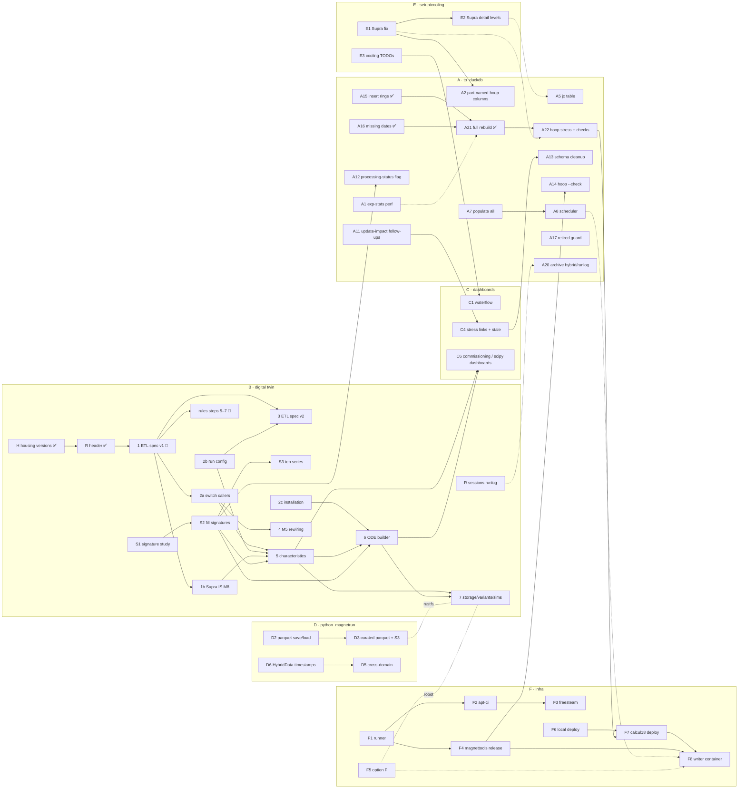

# magnetdb-duckdb-demo — Workspace Roadmap

*Snapshot: 2026-11-07 · branch `housing-config-versions` · previous snapshot 2026-11-05*

Umbrella roadmap over every plan file in this repository and its four
submodules (`python_magnetrun`, `python_magnetsetup`, `python_magnetgeo`,
`python_magnetcooling`). It **links to** the detailed plans and the two
component roadmaps rather than repeating them:

- [to_duckdb/ROADMAP.md](to_duckdb/ROADMAP.md) — detailed `to_duckdb` history, last updated 2026-08-21
- [python_magnetrun/prompts/ROADMAP.md](python_magnetrun/prompts/ROADMAP.md) — detailed `python_magnetrun` history, last updated 2026-06-11
- [PLAN_digital_twin_schema.md — Cross-plan order](PLAN_digital_twin_schema.md#cross-plan-order-blockers-and-approvals) — authoritative order for track B
- [PLAN_m1_project_sort.md](PLAN_m1_project_sort.md) — themed sort of the 50-item M1 note

Statuses below were checked against code and git history on 2026-11-07,
not only against each plan's own status line (see
[Status drift to fix](#status-drift-to-fix)). Files marked *uncommitted*
exist in the working tree but not in git yet.

**Legend.**
Status: ✅ done · 🔄 in progress · 📝 drafted, awaiting approval ·
💡 idea / sketch, no approvable plan · ⛔ blocked on external input ·
⏸ tabled / deferred · ❌ superseded / dropped.
Effort (relative, no calendar): S · M · L · XL · ? (not sizeable yet).

---

## Tracks at a glance

| Track | Scope | Open items | Next step |
|---|---|---|---|
| [A](#a--data-pipeline-to_duckdb) | `to_duckdb` schema, CLI, compute pipelines | 21 | `magnetdb-2026-11-05.duckdb` is in `to_duckdb/`; versions checked (A22, part); next hoop stress and the remaining A22 checks, then deploy the new DB to calcul18 (F7); approve A24 |
| [B](#b--digital-twin--etl) | installations, run config, characteristics, Pupitre ETL, signatures, sessions | 14 steps | file-check rules steps 1–5 done (step 5 on a scratch copy); next the dashboard tags (step 6) and keeping rules across rebuilds; approve the D1 = a code (text aligned 2026-11-07); approve step R (sessions); write the S1 execution choices |
| [C](#c--dashboards-appsdashboardsmagnetdb) | Dash app | 10 | evaluation with advanced users (F7); check the geometry colour on Magnet stats; approve C9 (CSV download) and C10 (hybrid viewer); reconcile C2; waterflow (C1) after E3 |
| [D](#d--python_magnetrun) | data-access library | 16 | `cirrus-mirror` and the `runetl` check rules committed; D2 parquet is ready to execute |
| [E](#e--python_magnetsetup--python_magnetgeo--python_magnetcooling) | setup / geometry / cooling libraries | 5 | approve E1 (Supra fix) — unblocks A2 and M8 |
| [F](#f--infrastructure-ci-packaging-deployment) | runner, apt depot, magnettools packaging, DB architecture, deployment | 9 | F7 evaluation on calcul18 (step 11); decide F5 (option F); approve F1 → F2 → F3; write the F9 plan (cirrus mirror on calcul18) |
| [G](#g--external-integrations--research) | external DBs/APIs, research items | 10 | mostly blocked on external input |

---

## A — Data pipeline (`to_duckdb`)

### Done since the 2026-11-02 snapshot

| Item | Evidence |
|---|---|
| A16 — empty date cells highlighted in dashboard tables + report-only `check --entity dates` (scope option 2, no `--fix`) ([plan](PLAN_missing_dates.md)) | `5e66207`; dashboard look confirmed by the user 2026-11-03 |
| `housing sync [--dry-run]` adds missing housings/versions from the bundled JSON; `housing view <H> [--at]` lists versions (track B step H) | `888f009` |
| Users demo: corrections and `--from` cutoff use `HStart`, not the unreliable log timestamp | `095449b` |
| Source JSON fixes and A15 rings committed in `hifimagnet-projects` (A15 step 7, G5 part) | hifimagnet-projects `4a926d8`, `612cafb`, `9338e22` |

### Done since the 2026-10-30 snapshot

| Item | Evidence |
|---|---|
| A15 — rings given to the insert magnets that had none (option C fit, sharing rule, `M25032101` rings excluded), written back to `hifimagnet-projects`, checked on a scratch rebuild ([plan](PLAN_insert_rings.md)) | `0ebb564` (`suggest_rings.py`, `rings_report.txt`); step 7 (commit in `hifimagnet-projects`, then one full rebuild) left — see G5, A21 |
| `magnet add` / `assembly add` are all or nothing; failures logged in `operation_log`, `Error: …` + exit 1 instead of a traceback ([plan](PLAN_atomic_load.md)) | 2026-10-29, plan committed in `ba24ca4` |
| "Commissioned into assembly" events dated with the link's `commissioned_at` instead of the import time ([plan addendum](PLAN_import_json_dates.md)) | `84d0079` |
| Rebuildable magnet geometry: magnet/assembly geometry never stored, rebuild checked and stored in `magnets.geometry_problem`, warning on `magnet add`, breaking part updates refused, colour on Magnet stats ([plan](PLAN_magnet_geometry_check.md)) — resolves [Q2](#open-questions) | `ba24ca4`, `5a4456d` (`magnet_geometry.py`), `9d0e486`; dashboard look awaits the user's check (step 5) |
| A18 — every state-changing `magnetdb.py` subcommand writes `operation_log` (gaps G1–G8, incl. `hoop-stress compute`) ([plan](PLAN_operation_log_coverage.md)) | `ef60cec` |

### Done since the 2026-10-16 snapshot

| Item | Evidence |
|---|---|
| Importer reads `manufactured_at` / `assembled_at` from the JSON, name date as fallback with a warning, implausible dates are errors ([plan](PLAN_import_json_dates.md)) | `195732c` (`crud.py` `_parse_json_date`, `_resolve_date`) — plan status line still says "proposed" |
| EXPERIENCES_LOG ↔ experiments linking report, acronym corrections, `users_table_demo.py` rework | `59197ad` (`demos/report_experiments_linking.py`) |
| Per-magnet data archive (`.tar.xz` + md5 manifest) ([plan](to_duckdb/PLAN_archive_magnet_data.md)) | `0ade81d` (`demos/archive_magnet_data.py`) |
| Pupitre experiment-file checker | `fb203f9` (`check_experiment_files.py`) |
| Corrupted files skipped in `compute_op_stats`; pupitre time changes (DST) handled in `compute_exp_stats` | `5b7a506`, `feb2df7` |
| magnettools optional in `to_duckdb` (only hoop-stress commands need it) — see F4 | `1e58ba9` (`stress_map.py`) |

### Done since the 2026-08-21 snapshot

| Item | Evidence |
|---|---|
| `operation_log` audit table + `magnetdb.py log` ([plan](to_duckdb/PLAN_operation_log.md)) | `e2389aa`; `schema.py`, `magnetdb.py` |
| Update-impact tracking: stale marking, `material update`, FK drop ([plan](PLAN_update_impact_tracking.md)) | approved + implemented 2026-10-08, `d7ede6a` (`to_duckdb/impact.py`) |
| Hoop-stress rainflow fatigue-bins matrix (`hoop_stress_fatigue_bins`) | in `schema.py`, committed — **no plan file was ever written** |
| Per-experiment hoop-stress processing record (`hoop_stress_processed`, `bin_config`, `stale_since`/`stale_reason`) | `schema.py` — covers the *stress* stage of the processing-status flag |
| `populate overview-records-from-json` | subcommand present in `magnetdb.py` |
| Lifecycle: auto-close at CRUD, enum-driven statuses | `5c938bd`, `753c056` |
| DB consistency check helper | `566e3f7`, `dd87797` |
| Fill missing `Magnet Sites` in proposals ([plan](PLAN_fill_magnet_sites.md)) | `Data/proposals_2026-07-22_with_sites.csv` |

Earlier work (dedup, hoop-stress Phases 1–5, lifecycle, site→assembly
rename Track A) is recorded in [to_duckdb/ROADMAP.md](to_duckdb/ROADMAP.md).

### Open

| ID | Item | Plan | Status | Effort | Depends on / blocker |
|---|---|---|---|---|---|
| A1 | `compute_exp_stats.py` ~3× faster, atomic per-file writes | [PLAN_exp_stats_performance.md](to_duckdb/PLAN_exp_stats_performance.md) | 📝 since 2026-10-09 | M | — (full reprocess ≈ 1.6 h today; matters for A21) |
| A2 | Hoop-stress columns named by part; Parquet sub-dir per assembly | [PLAN_hoop_stress_part_names.md](to_duckdb/PLAN_hoop_stress_part_names.md) | 📝 2026-10-15 | S–M | best after **E1** (M8 assemblies fail `load_magnettools` until then) |
| A3 | `incidents` entity linked to assembly/magnet/part + `status_history` | [PLAN_incident_tracking.md](to_duckdb/PLAN_incident_tracking.md) | 📝 since 2026-08-28 | M | — (M1 note item 31) |
| A4 | `part delete` command | [PLAN_part_delete.md](to_duckdb/PLAN_part_delete.md) | 📝 since 2026-08-28 | S | — (split from A3, independent) |
| A5 | `jc` table + supra-part `jc_name` link | [PLAN_jc_table.md](PLAN_jc_table.md) | 📝 since 2026-09-02 | S–M | relates to **E2** (detailed Supras) |
| A6 | Days-based date tolerance for fuzzy matching | [PLAN_fuzzy_date_tolerance.md](to_duckdb/PLAN_fuzzy_date_tolerance.md) | 📝 — partly covered by `d0fb3ce` and the `59197ad` linking rework | S | check what is left first |
| A7 | `populate all` composite subcommand | [PLAN_populate_all.md](to_duckdb/PLAN_populate_all.md) | 💡 | S | opens: hard-fail policy, `--reprocess` scope |
| A8 | Scheduled populate (systemd timer + `--settle-seconds`) | [PLAN_scheduled_populate.md](to_duckdb/PLAN_scheduled_populate.md) | 💡 | S–M | A7; runs in the writer container (F8) |
| A9 | Pluggable user sources (CSV / SUPERVISION MySQL / userdb API) | [PLAN_users_multi_source.md](to_duckdb/PLAN_users_multi_source.md) | 📝 Phase 1; ⛔ Phases 2–3 | M | SUPERVISION schema, userdb API shape — see [Q9](#open-questions) |
| A10 | EcoNRJ parameter inference (Tr, R, ImaxH, ImaxB) | [PLAN_econrj_parameter_inference.md](to_duckdb/PLAN_econrj_parameter_inference.md) | 💡 | M | meaning of `Tr`; fit granularity |
| A11 | Update-impact follow-ups 1–4, 6–7 (stale display, drift detection, insert angles, bores, portable geometry paths, update coverage); #5 dropped ([Q2](#open-questions)) | [PLAN_update_impact_tracking.md §Follow-ups](PLAN_update_impact_tracking.md) | 💡 each needs its own plan | S each | #1 feeds **C4** |
| A12 | Processing-status flag for the remaining stages (fatigue, signatures, plateaux, …) | — none | 💡 partly done (stress stage via `hoop_stress_processed`) | S–M | B S2 (defines the signature/plateaux stages) |
| A13 | Schema cleanup: drop `operationaldata`, `sum_x2_dt`, `exp_part_bin_stats`, maybe `magnets.geometry_data` (unset by design since [Q2](#open-questions); still written by `magnet add --geometry`) | [to_duckdb/TODOs.md](to_duckdb/TODOs.md) | 💡 | ? | C4 (retire `part_stats.py` consumers first) |
| A14 | Hoop-stress `--check` mode against `magnettools.Bmap.getHoop()` | [to_duckdb/TODOs.md](to_duckdb/TODOs.md) (POSTPONED) | ⛔ | S | fix in `~/github/my-magnettools`, then a reinstall — **F4** makes this routine |
| A17 | `assembly add` refuses retired/dead magnets; optional part-ID / design-ref collision guard in `magnet add` (case `R26021005`) | [PLAN_retired_magnet_guard.md](to_duckdb/PLAN_retired_magnet_guard.md) | 📝 awaiting approval | S | not in the A21 rebuild (source JSON already fixed); safeguard for future loads |
| A19 | `demos/plot_magnet_incidents.py`: defaults & spikes over a magnet's lifetime | [PLAN_magnet_incidents_plot.md](to_duckdb/PLAN_magnet_incidents_plot.md) | 📝 awaiting approval | S | — |
| A20 | Hybrid and run-log files in `archive_magnet_data.py` | [PLAN_archive_magnet_hybrid_runlog.md](to_duckdb/PLAN_archive_magnet_hybrid_runlog.md) | 📝 2026-10-22 | S | on-disk layout of hybrid/run-log files to confirm; columns empty today (fed by B step R) |
| A21 | Full rebuild from scratch with the fixed source JSON (`hifimagnet-projects/magnetdb.json`, fixes and rings committed there) and the housing-config versions (loaded by `assembly add`, so no `housing sync` and no separate recompute of the M8 stats since 2026-03-05 are needed) | `scripts/build_from_scratch.sh` | ✅ built on another machine from branch `housing-config-versions` (superproject `74cdd28`), available as `to_duckdb/magnetdb-2026-11-05.duckdb` since 2026-11-07; the DB in use (calcul18 Quadlet unit) is still `magnetdb-2026-10-08.duckdb` until F7 deploys the new one | M | A15 ✅; A1 would shorten it |
| A22 | After A21: hoop-stress compute (not in `build_from_scratch.sh`, `# TODO add hoop stress`; needs magnettools, absent from `.venv`) and checks on the new DB: `check --entity dates`, `housing_config_versions` holds `M8-260305`, M8 experiments since 2026-03-05 use `Ucoil14`; `pupitre_etl_magnet` starts empty (reload the checks with `etl import` once A25 is done, then `check_experiment_files.py --etl`) | — | 🔄 checked read-only 2026-11-07: 6 housing versions incl. `M8-260305` ✅; `pupitre_etl_magnet` 0 rows (as expected); `hoop_stress_processed` 0 rows (hoop stress not run); no `tags`/`check_rules`/`record_tags` (built before the rules code: the first `tag add`/`rule add` creates them); 6542 experiments, 1952 overview records. Left: hoop stress, `check --entity dates`, M8 `Ucoil14` check | S–M | A21; M8 hoop stress waits for **E1**; doing A2 first avoids a second full stress run |
| A23 | `MAINTENANCE` codes in `LNCMI Tech Staff`, applied by the build | [PLAN_tech_staff_research_area.md](to_duckdb/PLAN_tech_staff_research_area.md) | 📝 plan saved 2026-11-03, implementation awaiting approval | S | not in the A21 rebuild: reaches the DB at the next build |
| A24 | Build `overview_records` with SQL over `operationaldata` (file start/end and Overview `mode` computed once per file and stored, no re-read over the records mount); rename pigbrother "Stats" files to **SignalStats** from python_magnetrun to the dashboard | [PLAN_overview_records_from_operationaldata.md](PLAN_overview_records_from_operationaldata.md) | 📝 draft 2026-11-06, awaiting approval | M | — ; ManuelTrig and Stats files are not registered in `operationaldata` yet |
| A25 | Keep tags, check rules and magnet wirings across rebuilds: `hifimagnet-projects/magnetdb.json/pupitre_checks.json`, `etl import` / `etl dump`, build step `etl-config` | [PLAN_pupitre_checks_file.md](PLAN_pupitre_checks_file.md) | 🔄 approved 2026-11-07 | S | B file-check rules step 5 ✅; the wiring key changes with the D1 = a code |

**Order for the data-quality chain:** JSON dates ✅ → A15 ✅ → A16 ✅ → A21 rebuild ✅ → A22 → deploy the new DB to calcul18 (F7).

---

## B — Digital twin & ETL

Order, blockers and approvals come from
[PLAN_digital_twin_schema.md](PLAN_digital_twin_schema.md#cross-plan-order-blockers-and-approvals).
**Approved so far: steps 0, E, H, R (header) (done), step 1 parts A and B (done), the file-check rules (steps 1–4 done) and the S1 methodology.**
Steps 1, S1, 2b and 2c can run in parallel. This track takes over
`to_duckdb/ROADMAP.md`'s former Open Questions 1 (lag) and 2 (plateaux), and
its Later item "Commissioning data structure".

"Step R" below is the sessions follow-up of [PLAN_session_records.md](PLAN_session_records.md);
the schema plan's own step R (header resolution order) is listed as **R (header)**.

### Done since the 2026-11-05 snapshot

| Item | Plan | Evidence |
|---|---|---|
| File-check rules steps 1–4: `tags` (seeded `check:channel_not_empty`), `check_rules` (housing / assembly / magnet, optional housing version), `record_tags`; `magnetdb.py tag …` / `rule …`; `check_experiment_files.py --etl` stores the tags of failed checks; spec format 2 (rules replace the `Icoil` current check, `max_abs` / `p99_abs` / `mean_abs`); magnet parts renamed **wiring** (`set_magnet_wiring`) | [PLAN_file_check_rules.md](PLAN_file_check_rules.md) | `57a95bf`; python_magnetrun `9db713b` |
| Documents only: ETL D1 revised b → a (magnet parts with `valid_from` / `valid_to`, one spec per period, `spec_period` check; code not done); header versions with a status (`stale` / `commissioning` / `valid`), data issue #12 (`M25032101` H1–H4 on `Ucoil2` since 2025-05-09), probes as FEM inputs (`v_probe_coherence`), open questions #31–#33 | [PLAN_pupitre_etl_spec.md](PLAN_pupitre_etl_spec.md), [PLAN_digital_twin_schema.md](PLAN_digital_twin_schema.md) | `bd47b13` |

### Done since the 2026-11-02 snapshot

| Item | Plan | Evidence |
|---|---|---|
| Step H — time-versioned housing config: `HousingConfig.versions` / `.at(t0)` in the bundled JSON, resolved at data start by every caller; `cleanupData` keeps `keys_to_add` columns; DuckDB `housing_config_versions`; first version `M8-260305` (M8 Bitters on `Ucoil14` since 2026-03-05) | [PLAN_digital_twin_schema.md](PLAN_digital_twin_schema.md) (cross-plan row H) | `dfe5610`; python_magnetrun `311c284` |
| R (header) — header resolution order (assembly → housing version → header), documents only | [PLAN_digital_twin_schema.md](PLAN_digital_twin_schema.md) (cross-plan row R, L2 "Pupitre header reader") | `2eb5099` |
| Step 1 parts A and B — Pupitre ETL spec per (assembly, housing version): `PupitreEtlSpec`, `prepare_pupitre`, `txt2csv` options; DuckDB `pupitre_etl_magnet`, `file_context.py`, `magnetdb.py etl set-magnet\|show\|export`, `check_experiment_files.py --etl`; `load_mrun` / `fromtxt` ETL arguments. Opt-in: no caller switched yet (step 2a) | [PLAN_pupitre_etl_spec.md](PLAN_pupitre_etl_spec.md) | `055491f`, `0cc94e3`, `dd5e75f`, `9f7c72e`; python_magnetrun `eaf8ca2`, `b439c4a`, `d2e79e7`, `b565da6`, `09935ff` |

### Done since the 2026-10-16 snapshot

| Item | Plan | Evidence |
|---|---|---|
| Step E — file quality on `experiments` (`header_class`, `file_integrity` ok / truncated / unreadable, `file_checks`), filled in `magnetdb-2026-10-08.duckdb` | L2 in [PLAN_digital_twin_schema.md](PLAN_digital_twin_schema.md) | `2ce7a09`; python_magnetrun `4caf41c` |
| Pupitre files with a binary crash tail load their valid rows (`truncated`, not `unreadable`); single-row files; DST rules for filenames | [PLAN_pupitre_binary_tail.md](PLAN_pupitre_binary_tail.md) | `feb2df7`, `5b7a506`; python_magnetrun `17c16f9`, `b3344bd` |
| `magnetrun sessions`: one record per EXPERIENCES_LOG session (2018 → now) listing overview, archive, pupitre, incident, stats, hybrid and runlog files; unlogged files grouped | [PLAN_session_records.md](PLAN_session_records.md), checks in [NOTES_session_records_checks.md](NOTES_session_records_checks.md) | python_magnetrun `b75b6a9` (on `origin/spike/tdms-polars-benchmark`), pinned by the superproject in `0987dae`, dropped by `ffdb347`, restored by merge `a77f37c` (superproject `74cdd28`) |
| Cirrus A1 run-log analysis: reference current rebuilt from the log; 180/202 sessions matched to experiments; client IP → housing; 2014 clock dates | [NOTES_cirrus_A1_runlogs.md](NOTES_cirrus_A1_runlogs.md), [NOTES_cirrus_A1_experiment_matching.md](NOTES_cirrus_A1_experiment_matching.md) *(uncommitted)* | analysis 2026-10-16; python_magnetrun `909b2c6` (cirrus logs) — input for #27 and step R |

### Open

| Step | Work | Plan | Status | Depends on | Blocker |
|---|---|---|---|---|---|
| 0 | Reconcile plan documents | — | ✅ 2026-10-07 | — | — |
| E | File quality on `experiments` | L2 in the [schema plan](PLAN_digital_twin_schema.md) | ✅ 2026-10-22 | — | — |
| H | Time-versioned housing config | cross-plan row H in the [schema plan](PLAN_digital_twin_schema.md) | ✅ 2026-11-03 | — | — |
| R (header) | Header resolution order (documents only) | cross-plan row R in the [schema plan](PLAN_digital_twin_schema.md) | ✅ 2026-11-03 | H | — |
| R | Sessions follow-up: find the pigbrother run log (`pigbrother_runlog` in `summary.json` / `sessions.json`); other follow-ups (archive size threshold, `power_end`, range cache, overview continuation rule) | [PLAN_session_records.md §Follow-up step R](PLAN_session_records.md#follow-up-step-r-pigbrother-runlog-path-proposed-2026-10-23) | 📝 step R awaiting approval; other follow-ups need decisions | sessions ✅ | — |
| S1 | Signature regime robustness study (incl. lag Side A vs Side B, robust `Field` signature) | [PLAN_signature_regime_robustness.md](apps/dashboards/magnetdb/PLAN_signature_regime_robustness.md) | 📝 methodology approved, not run | — | tooling location; RDP vs PELT; test-file set |
| S2 | Fill `overview_records.signatures`/`plateaux`/`sync_info` with real output | to write | 💡 | S1 | — |
| S3 | `teb` as a time series, shifted by stored lag | to write | 💡 | S2 | one-offset-per-file assumption |
| 1 | Pupitre ETL spec v1 | [PLAN_pupitre_etl_spec.md](PLAN_pupitre_etl_spec.md) | 🔄 parts A and B committed with D1 = b (opt-in path). D1 = a (revised 2026-11-05) documented, its text aligned with the wiring and rules naming on 2026-11-07 (check rules keep the housing-version axis); its code awaits approval. The current-check tolerance during transients is covered by the file-check rules (`p99_abs`). Follow-ups, each needing its own plan: re-export specs when a housing version is added, `etl_checks` in the dashboards, raw pupitre view in `file_viewer` | H, R (header) | none |
| 1 (rules) | File-check rules steps 5–7: M9 rules on a copy of the new DB (tolerances measured first), dashboard tag colours and tooltips, docs (`to_duckdb/docs/schema.md`, python_magnetrun README) | [PLAN_file_check_rules.md](PLAN_file_check_rules.md) | 🔄 approved; steps 1–4 done (`57a95bf`); step 5 done 2026-11-07 on a scratch copy of the new DB (M9: `IH_vs_Icoil2` p99 ≤ 5 A tags no file, DCCT rules tag 20 of 190, channel tag checked). Left: dashboard (6), docs (7), and a plan to keep rules/wirings across rebuilds | 1 | — |
| 1b | Supra current `IS` for M8; hybrid loading moved into python_magnetrun | outline in [PLAN_pupitre_etl_spec.md](PLAN_pupitre_etl_spec.md) | 💡 outline agreed | 1 | #27 Hybrid ↔ pupitre clock lag (M8 work started, `00e6467`; cirrus notes give a measured offset method) |
| 2a | Switch Pupitre callers (`load_mrun`, dashboards, `stress_map.py`) to the spec path | to write | 💡 | 1 | — |
| 2b | Phase 2: probes + L2 run configuration + `v_config_sections` | to write | 💡 | — | #2, #17, #20 (MAGFILE support landed in python_magnetrun `fc3dc54`) |
| 2c | Phase 1: L1 installation (PID, Ivar) | to write | ⛔ | — | **CIRRUS XML history access** |
| 3 | Pupitre ETL spec v2, driven by the assembly | to write | 💡 | 1, 2b | — |
| 4 | M5 rewiring | [NOTES_M5_bitters_wiring.md](NOTES_M5_bitters_wiring.md) | ⏸ notes on hold | 2a, (3) | formal confirmation of M5 wiring |
| 5 | Phase 3: L3 characteristics + raw commissioning tables | to write | 💡 | 2a, 2b, 1b, S2, E ✅ | #22–#25 |
| 6 | Phase 4: ODE config builder (magnet_scipy inputs) | to write | 💡 | 2c, 5, S2 | `materials.alpha`; empty signatures until S2 |
| 7 | Phases 5–7: storage, L4 digital variants, L5 simulations | to write | 💡 | 5, 6 | #10 rustfs instance (shared with **D3**); online sim ↔ live comparison is also the "robot" role of F5 option F |
| — | Commissioning measurements + numerical companion | [PLAN_commissioning_numerical_companion.md](PLAN_commissioning_numerical_companion.md) | ❌ superseded — §1 merged into step 5 | — | — |

---

## C — Dashboards (`apps/dashboards/magnetdb`)

### Done since the 2026-11-02 snapshot

| Item | Plan | Evidence |
|---|---|---|
| Overview/Archive viewer page for `operationaldata` | [PLAN_operational_viewer.md](apps/dashboards/magnetdb/PLAN_operational_viewer.md) | `ee1433f` (`pages/operational_viewer.py`) |
| Assembly and magnet history in Magnet/Part stats sorted newest first | — | `a88051c` |
| Empty date cells highlighted (A16) | [PLAN_missing_dates.md](PLAN_missing_dates.md) | `5e66207` |
| Housing-config versions shown in the dashboard (track B step H) | [PLAN_digital_twin_schema.md](PLAN_digital_twin_schema.md) | `dfe5610` |

### Done since the 2026-10-30 snapshot

| Item | Plan | Evidence |
|---|---|---|
| About page: operation log in a collapsible `html.Details` block | [PLAN_dashboard_tables_newest_first.md](PLAN_dashboard_tables_newest_first.md) | `0987dae` — 10 per page still open (C8) |
| Magnet stats coloured by `magnets.geometry_problem` (track A geometry check) | [PLAN_magnet_geometry_check.md](PLAN_magnet_geometry_check.md) | `ba24ca4` (`magnet_stats.py`, `dash_selectors.py`); look awaits the user's check |

### Done since the 2026-10-16 snapshot

| Item | Plan | Evidence |
|---|---|---|
| Per-user plot style in browser `localStorage`, export/import, "Reset all"; nothing written under `$HOME/.config` | [PLAN_per_user_plot_style.md](apps/dashboards/magnetdb/PLAN_per_user_plot_style.md) | `998158d` |
| Selected database kept in a cookie | — | `99065fe`, `3b81559` |
| Dated tables open newest first (groups keep their order; charts stay oldest first) | [PLAN_dashboard_tables_newest_first.md](PLAN_dashboard_tables_newest_first.md) | `8614a4a`, `1c8d571` — the About-log part is still open (C8) |
| `sync_zoom` handling in the File viewer | — | `75d6a8a`, `b3343bc` |
| More information on experiments on the About page (en/fr/de/nl) | — | `257812f` |
| GitHub issue template for dashboard feedback | — | `6f124c8` (`.github/ISSUE_TEMPLATE/dashboard.yml`) |
| Dashboard image without magnettools; local Docker + Traefik deployment | see F4, F6 | `33099cc`, `949a260` |

### Done since the 2026-08-21 snapshot

| Item | Plan | Evidence |
|---|---|---|
| i18n (en/fr/de/nl) + 🌐 selector | [PLAN_dashboard_i18n.md](PLAN_dashboard_i18n.md) | `d1cecff`, `b0b1bd3` (`src/i18n.py`) |
| Database summary banner | [PLAN_database_summary_banner.md](PLAN_database_summary_banner.md) | `df0ca56`, `df3b273` |
| Graph CSV download | [PLAN_graph_csv_download.md](PLAN_graph_csv_download.md) | `19e67c5` |
| Click-to-pin cursor sync | [PLAN_cross_graph_cursor_sync.md](apps/dashboards/magnetdb/PLAN_cross_graph_cursor_sync.md) | `d3a2c89` |
| Per-field style overrides + gear icon | [PLAN_field_style_overrides.md](apps/dashboards/magnetdb/PLAN_field_style_overrides.md) | `style_editor.py`, used on 3 pages |
| Sensor group order | [PLAN_group_order.md](apps/dashboards/magnetdb/PLAN_group_order.md) | `53aa756` |
| Date filters on Experiments/Overview tables | [PLAN_experiment_overview_date_filters.md](apps/dashboards/magnetdb/PLAN_experiment_overview_date_filters.md) | committed |
| Per-region loading spinner | [PLAN_loading_spinner_scope.md](apps/dashboards/magnetdb/PLAN_loading_spinner_scope.md) | `bf52c5a` |
| SUPERVISION `bdd` data in viewers | [PLAN_supervision_bdd_file_viewer.md](PLAN_supervision_bdd_file_viewer.md) | `8089706` |
| Incident-file curves on Defaults & Spikes | [PLAN_defaults_spikes_incident_data.md](apps/dashboards/magnetdb/PLAN_defaults_spikes_incident_data.md) | 2026-10-15, `0afaeb9` |
| Hoop-stress history in Part stats | [PLAN_part_stats_hoop_stress.md](apps/dashboards/magnetdb/PLAN_part_stats_hoop_stress.md) | committed |
| Research-area, TDMS stats viewer, About pages; magnet-time coloured by field range; DB-change callback | — | `048cb57`, `5d66fab`, `d24a82d`, `7155c22`, `f7ebd36` |

### Open

| ID | Item | Plan | Status | Effort | Depends on / blocker |
|---|---|---|---|---|---|
| C1 | Waterflow comparison page (+ root fix of cwd-dependent `importlib.resources`) | [PLAN_waterflow_dashboard.md](PLAN_waterflow_dashboard.md) | 📝 no status line, not implemented | M | **E3** (waterflow_factory rework); the resources part may be partly done (`597b56f`) |
| C2 | Click an event marker to lazily load that event file | [PLAN_overview_records_event_click.md](apps/dashboards/magnetdb/PLAN_overview_records_event_click.md) | 📝 draft, diverged | S | possibly superseded by the eager toggle + Defaults & Spikes curves — [Q3](#open-questions) |
| C3 | Magnet stats Housing/Year filter | [PLAN_magnet_stats_year_filter.md](apps/dashboards/magnetdb/PLAN_magnet_stats_year_filter.md) | ⏸ tabled 2026-08-20 | S | — |
| C4 | Stress/fatigue linking in assembly/magnet stats; show stale results | [to_duckdb/ROADMAP.md](to_duckdb/ROADMAP.md) Later; A11 #1 | 💡 | S–M | A11 #1 |
| C5 | Table technology for trend columns (great_tables nanoplot vs DataTable+base64 vs ag-grid Enterprise) | [PLAN_m1_project_sort.md §3b](PLAN_m1_project_sort.md) | 💡 decision open | ? | [Q6](#open-questions) |
| C6 | M1-note dashboards: pigbrother `Champ_magn` in overview (13), fault annotations (26/30), commissioning (45), magnet_scipy comparison (46), energy balance (47) | [PLAN_m1_project_sort.md](PLAN_m1_project_sort.md) | 💡 | M each | 45 → B step 5; 46 → B step 6 |
| C7 | Comparison-page performance (`PERFORMANCE_PLAN.md`) | — | ❌ plan file removed; page in `pages_disabled/` | — | — |
| C8 | About page: operation log 10 per page (latest first) | [PLAN_dashboard_tables_newest_first.md](PLAN_dashboard_tables_newest_first.md) | 📝 remainder of an implemented plan (collapsible since `0987dae`; `about.py` still `page_size=20`) | S | — |
| C9 | Wide-format CSV download | [PLAN_csv_download.md](apps/dashboards/magnetdb/PLAN_csv_download.md) | 📝 proposed 2026-11-03 | ? | — |
| C10 | Hybrid viewer page | [PLAN_hybrid_viewer.md](apps/dashboards/magnetdb/PLAN_hybrid_viewer.md) | 📝 drafted 2026-11-03 | ? | relates to B step 1b (hybrid loading moved into python_magnetrun) |

Tester
feedback from the calcul18 evaluation (F7) will arrive as GitHub issues
through the `6f124c8` template.

---

## D — `python_magnetrun`

Only open and recent streams are listed here. Completed history lives in
[python_magnetrun/prompts/ROADMAP.md](python_magnetrun/prompts/ROADMAP.md).

### Done since the 2026-11-05 snapshot

| Item | Plan | Evidence |
|---|---|---|
| `runetl` check rules (spec format 2): `rules` in `PupitreEtlSpec`, evaluated with `DataFrame.eval`; `current` and `ICOIL_CHECK_ATOL` removed; `etl show` prints the rules — B file-check rules | [PLAN_file_check_rules.md](PLAN_file_check_rules.md) | `9db713b` |
| `magnetrun cirrus-mirror`: raw cirrus logs and CIRRUS XMLs from srv-data-install into `<root>/cirrus/<feed>/` (stage D; full 2026 back-fill ≈ 1.8 GB done locally) | `PLAN_cirrus_mirror.md` *(local, git-ignored)* | `37dda4d` |
| Examples: compare / plot a SUPERVISION `bdd.csv` export against a pupitre aggregate csv (clock offset, default 7196 s) | — | `321cecd` |

### Done since the 2026-11-02 snapshot

| Item | Plan | Evidence |
|---|---|---|
| Time-versioned housing config (`HousingConfig.versions` / `.at(t0)`) — B step H | [PLAN_digital_twin_schema.md](PLAN_digital_twin_schema.md) | `311c284` |
| Pupitre ETL spec part A (`PupitreEtlSpec`, `prepare_pupitre`, etl CLI); `fromtxt` forwards ETL arguments; `txt2csv` opt-in spec options, working imports and logging (its plot options remain broken); `load_mrun` explicit ETL arguments — B step 1 | [PLAN_pupitre_etl_spec.md](PLAN_pupitre_etl_spec.md) | `eaf8ca2`, `b439c4a`, `d2e79e7`, `b565da6`, `09935ff` |
| `correlations` accepts narwhals frames; `get-record` narwhals-backed with `--housing ALL`; `mysql_connect --utc/--no-utc` (naive UTC export by default) | — | `78db2c9`, `d23d7b8`, `73eb198` |
| Spike `b75b6a9` (sessions, end times) merged back after `ffdb347` had dropped its pin; 1409 tests pass (the 10 failures / 24 errors that remain come from Git LFS pointer files in `data/`) | [PLAN_session_records.md](PLAN_session_records.md) | `a77f37c`; superproject `74cdd28` |

### Done since the 2026-10-16 snapshot

| Item | Plan | Evidence |
|---|---|---|
| File quality on experiments: truncation reported to `to_duckdb` (B step E) | [PLAN_digital_twin_schema.md](PLAN_digital_twin_schema.md) L2 | `4caf41c` |
| Time changes (DST) within a pupitre file; polars UTF-8 errors on binary tails | [PLAN_pupitre_binary_tail.md](PLAN_pupitre_binary_tail.md) | `17c16f9`, `b3344bd` |
| Cirrus run-log download (`requests.cirrus_logs`), sorted by time | [NOTES_cirrus_A1_runlogs.md](NOTES_cirrus_A1_runlogs.md) | `909b2c6`; superproject `e0b4a10` |
| `magnetrun sessions` (`analysis/sessions.py`), `FileDiscovery.discover_window`, archive/pupitre end times in `extract_data`; 1350 tests pass | [PLAN_session_records.md](PLAN_session_records.md) | `b75b6a9` — pinned by the superproject in `0987dae`, dropped by `ffdb347`, restored by `a77f37c` |

### Done since that roadmap's 2026-06-11 update (not yet reflected there)

| Item | Plan | Evidence |
|---|---|---|
| Polars MagnetData for pupitre | [polars-magnetdata-pupitre.plan.md](python_magnetrun/prompts/polars-magnetdata-pupitre.plan.md) | ✅ in plan; `magnetdata_polars.py` |
| Narwhals downstream consumers | [narwhals-downstream-consumers.plan.md](python_magnetrun/prompts/narwhals-downstream-consumers.plan.md) | `6fec823` |
| TdmsMagnetData → polars by default; custom `nptdms` live (part of Stream 4.3) | [mrun-cache-implementation.plan.md](python_magnetrun/prompts/mrun-cache-implementation.plan.md) | `1892c37`; plan says ✅ Live |
| Trigger & VProcess plotting (Stream 4.6) | [4.6-trigger-vprocess-plotting.plan.md](python_magnetrun/prompts/4.6-trigger-vprocess-plotting.plan.md) | `plot_vprocess_variable` in `hybrid_data.py` |
| TDMS stats files, archive-TDMS file discovery, MAGFILE data, SUPERVISION `bdd` defs, MySQL export sort, thread-safe pint registry, bandit hook | — | `eea0dbe`, `3e57785`, `fc3dc54`, `5c827c5`, `077800f`, `6e22643`, `5362867` |

### Open

| ID | Item | Plan | Status | Effort | Depends on / blocker |
|---|---|---|---|---|---|
| D1 | TDMS polars export benchmark spike | [tdms-polars-benchmark.plan.md](python_magnetrun/prompts/tdms-polars-benchmark.plan.md) | 🔄 — the superproject pins branch `housing-config-versions`, which contains `spike/tdms-polars-benchmark` (merge `a77f37c`; see Q1) | S | — |
| D2 | Parquet save/load with rich metadata (Stream 4.7, Phases 1–7) | [parquet-save-load.plan.md](python_magnetrun/prompts/parquet-save-load.plan.md) | 📝 fully designed (D1–D8), all ⏳ | M (~3 d) | — |
| D3 | Curated Parquet input + S3-backed file access | [curated-parquet-s3.plan.md](python_magnetrun/prompts/curated-parquet-s3.plan.md) | 💡 discussion notes | M | D2; rustfs instance (shared with B step 7) |
| D4 | Phase 2D side-by-side comparison (`plot_comparison(list[DataLoader])`) | [ROADMAP §2D](python_magnetrun/prompts/ROADMAP.md) | 💡 unblocked | M | — |
| D5 | Cross-domain comparison Phases D–G + 3.7 pattern entries in `*-defs.json` | `cross-domain-comparison.prompt.md`, [ROADMAP §4.2](python_magnetrun/prompts/ROADMAP.md) | 💡 (`ComparisonSession` not started) | L | D6 |
| D6 | `HybridData` timestamp support (Stream 4.1) | [hybriddata-timestamp-plan.md](python_magnetrun/prompts/hybriddata-timestamp-plan.md) | ❓ `addTime` present in `hybrid_data.py` — verify | S | — |
| D7 | snake_case migration with deprecation shims (required by CLAUDE.md) | [snake-case-migration.plan.md](python_magnetrun/prompts/snake-case-migration.plan.md) | 📝 Pass 1 not started; open questions in plan | L | — |
| D8 | Test coverage → 80 % | [coverage-80pct.plan.md](python_magnetrun/prompts/coverage-80pct.plan.md) | ❓ status unknown | M | — |
| D9 | Label/legend uniformization | [label-legend-uniformization.plan.md](python_magnetrun/prompts/label-legend-uniformization.plan.md) | ❓ plan shows 12 open steps; superproject `6577295`/`f3f9334` changed labels | S | verify |
| D10 | TDMS export (Stream 4.5) | [ROADMAP §4.5](python_magnetrun/prompts/ROADMAP.md) | 💡 | M ×3 | — |
| D11 | Multiple-file `vs_time` regression (Stream 1) | [ROADMAP §1](python_magnetrun/prompts/ROADMAP.md) | 💡 open since May | S | — |
| D12 | mypy, logging migration, quick wins | [ROADMAP](python_magnetrun/prompts/ROADMAP.md) | 💡 background | S | — |
| D13 | marimo tutorial notebooks | [marimo-tutorial.plan.md](python_magnetrun/prompts/marimo-tutorial.plan.md) | 💡 not started (only `.ipynb` notebooks exist) | M | — |
| D14 | Dash / pywry / Textual GUIs | [dash-plan](python_magnetrun/docs/dash-plan.md), [gui-plan](python_magnetrun/docs/gui-plan.md), [tui-plan](python_magnetrun/docs/tui-plan.md) | 💡 not started | L | overlaps track C — [Q4](#open-questions) |
| D15 | HoloViews plotting migration | [holoviews-migration.plan.md](python_magnetrun/prompts/holoviews-migration.plan.md) | ⏸ optional | M | — |
| D16 | Legacy TODO list (spike removal, smoothing, mrecord rework, …) | [python_magnetrun/TODO.md](python_magnetrun/python_magnetrun/TODO.md) | 💡 unsorted | ? | partly superseded by B |

Archive TDMS files log formula warnings (`Référence_GR2 = Référence_A3 +
Référence_A4`, variables missing in `M9_Archive_*`); seen during F7, a
`*-defs.json` configuration issue, the files still load.

---

## E — `python_magnetsetup` / `python_magnetgeo` / `python_magnetcooling`

| ID | Item | Plan | Status | Effort | Depends on / blocker |
|---|---|---|---|---|---|
| E1 | Fix the Supra branch of `magnet_setup` (`DetailLevel.NONE`), deb runtime deps, tests run at .deb build | [python_magnetsetup/PLAN_supra_umagnet.md](python_magnetsetup/PLAN_supra_umagnet.md) | 📝 2026-10-15 (plans committed in `cf9718a`) | M | — ; **unblocks A2 and the M8 assemblies** |
| E2 | Supra detail levels DBLPANCAKE / PANCAKE / TAPE | [python_magnetsetup/PLAN_supra_detail_levels.md](python_magnetsetup/PLAN_supra_detail_levels.md) | 📝 2026-10-16 | M–L | E1; relates to A5 (`jc`) |
| E3 | Cooling TODOs: thermohydraulics check (gradHZH), z-dependent dh/sh, waterflow_factory via magnetrun, mrun input for waterflow pipeline, secondary-flow hysteresis | [python_magnetcooling/TODOs.md](python_magnetcooling/TODOs.md) | 💡 no plans | ? | feeds C1 |
| E4 | Cooling models from the M1 student (primary heat exchanger) | [to_duckdb/ROADMAP.md](to_duckdb/ROADMAP.md) Later | ⛔ | M | student's models |
| E5 | `python_magnetgeo` | — | no open plans | — | Track B of the rename is under G3 |

Reference: [Cooling Boundary Conditions for Electromagnets.md](Cooling_Boundary_Conditions_for_Electromagnets.md)
*(uncommitted, 2026-10-09)*: per-magnet Robin condition (h, T_w) driven by
each magnet's own current and pump; background for E3 and B step 6.

---

## F — Infrastructure, CI, packaging, deployment

| ID | Item | Plan | Status | Effort | Depends on / blocker |
|---|---|---|---|---|---|
| F1 | Self-hosted GitHub runner (`ghrunner`, `MagnetDB/apt-depot` only) | [PLAN_github_runner_setup.md](PLAN_github_runner_setup.md) | 📝 | S | host to confirm (the plan says calcul22, now the dev workstation only) |
| F2 | `apt-ci` upload path to euler + generic build workflow | [PLAN_apt_ci_upload.md](PLAN_apt_ci_upload.md) | 📝 | M | F1 |
| F3 | freesteam Debian package on release | [PLAN_freesteam_deb_ci.md](PLAN_freesteam_deb_ci.md) | 📝 | S | F1, F2 |
| F4 | magnettools release pipeline (deb + wheel + public image) | [PLAN_magnettools_release_pipeline.md](PLAN_magnettools_release_pipeline.md), [NOTES_auditwheel_spike.md](NOTES_auditwheel_spike.md) | 📝 Phase 1; 🔄 Phase 2 — first slice [PLAN_magnettools_optional.md](PLAN_magnettools_optional.md) steps 0–5 ✅ (`1e58ba9`, `33099cc`: magnettools optional, `debian:trixie` devcontainer fed by `magnettools-db:trixie-1.2.6`), step 6 (devcontainer rebuild in VS Code) left to the user | L | F1 (its step 9 revises "no runner"); GPL `libgsl`/`libfreesteam` licensing for public binaries; unblocks A14, hoop-stress tests |
| F5 | DuckDB ↔ PostgreSQL (`python_magnetdb`) architecture | [PLAN_duckdb_postgres_merge.md](PLAN_duckdb_postgres_merge.md) (follow-up discussion 2026-10-28), [PLAN_duckdb_master_control_plane.md](PLAN_duckdb_master_control_plane.md), [NOTES_python_magnetdb_deployment.md](NOTES_python_magnetdb_deployment.md) | 📝 **option F** proposed 2026-10-28: DuckDB master for all magnet data, Postgres for shared control data only, python_magnetdb as a thin API over `to_duckdb`, `simulator`/`robot` roles; supersedes "Solution 1". python_magnetdb deployment delayed (notes only) | XL | [Q10](#open-questions); each phase gets its own plan |
| F6 | Plan 1 — dashboard on the dev machine (Docker, read-only snapshot, Traefik `:8443`) | [PLAN_dashboard_local_deployment.md](PLAN_dashboard_local_deployment.md) | 🔄 steps 0–5, 7, 10, 11 passed; 6, 8, 9 left; plan 1b (calcul22) not needed | S | — |
| F7 | Plan 2 — dashboard on **calcul18** (rootless Podman + Quadlet as user `magnetdb`, uid 1004; Traefik `:8443`, mkcert CA + basicAuth; read-only records via rclone 1.75.2 and a restricted sftp key) | [PLAN_dashboard_server_deployment.md §Target: calcul18](PLAN_dashboard_server_deployment.md#target-calcul18-2026-10-30), units in `scripts/quadlet/`, [tester note](apps/dashboards/magnetdb/docs/evaluation_tester_note.md) *(French)* | 🔄 evaluation with advanced users approved 2026-10-30; steps 1–9 passed, step 10 automated part passed (maintainer's browser check pending), step 11 (testers) pending; `~/.config/magnetdb` mounted for style/group order (`8eb205d`); the new DB from A21/A22 is to be deployed (CHECKPOINT, rsync DB + `hoop_parquet/`, `mv` over the live file — fixed vs dated file name still open) | M | wired LNCMI network only (VPN does not pass `:8443`); open findings: no client IP in the access log, records key reads all of `/mnt/pve/DATA` |
| F8 | Plan 3 — `to_duckdb` writer container (private image from `magnettools-db`, read-write on demand) | [PLAN_dashboard_server_deployment.md §Plan 3](PLAN_dashboard_server_deployment.md#plan-3-to_duckdb-writer-container) | 💡 draft notes | M | F7; once it runs, the server holds the master DB; relates to F5 (API process as sole DuckDB writer) |
| F9 | Cirrus raw-log mirror on calcul18 (stage B: scheduled `magnetrun cirrus-mirror` into the server's runlog root) | `PLAN_cirrus_mirror.md` *(local, git-ignored)*, draft at its end | 💡 draft; stage D (code, local back-fill) ✅ `37dda4d` | S | F7 host; feeds B step R, A20 and the L1 "CIRRUS XML history" blocker of B step 2c |

Known infra issue: the File viewer hang on the records mount was a
**rclone 1.60 VFS-cache deadlock**, not a dashboard bug
([PLAN_dashboard_local_deployment.md §File viewer hang](PLAN_dashboard_local_deployment.md#file-viewer-hang-rclone-160)).
Fixed on calcul24 and calcul18 with rclone 1.75.2; calcul22 still runs 1.60.

---

## G — External integrations & research

| ID | Item | Source | Status | Blocker |
|---|---|---|---|---|
| G1 | B-profile → currents inversion; experiment-planning optimizer | [M1 sort §E](PLAN_m1_project_sort.md) | ⛔ | formula from Cedric/Romain |
| G2 | `python_magnetrun/requests` read **and write** to Cedric's DB; M7/M8 assembly configs | M1 sort §F (29/50) | ⛔ | authorization — [Q7](#open-questions) |
| G3 | Site→Assembly rename Track B (`python_magnetdb`, `python_magnetapi`) + magnetapi bulk-import test | [PLAN_site_to_assembly_rename.md](PLAN_site_to_assembly_rename.md) | ⏸ deferred | separate repos; may be reshaped by F5 option F |
| G4 | Engie API linked to experiments | M1 sort §F (42) | 💡 | — |
| G5 | `hifimagnet-projects`: M7/M8 assembly setup, bitter status cleanup, bitter naming convention (the 2026-10-28 JSON fixes and the 2026-10-29 rings, A15 step 7, are committed: `4a926d8`, `612cafb`, `9338e22`) | [to_duckdb/TODOs.md](to_duckdb/TODOs.md), M1 sort §F/G | 💡 | cahier E. Verney |
| G6 | Field validation M8–M10 (`Field + Supra_Field == Total_Field`) | [to_duckdb/TODOs.md](to_duckdb/TODOs.md) | 💡 | — |
| G7 | Pre-2022 pigbrother data (NAS 2018–2021) | [to_duckdb/TODOs.md](to_duckdb/TODOs.md) | ⛔ | availability unknown |
| G8 | Special experiments (M19, negative IH/IB) | [to_duckdb/TODOs.md](to_duckdb/TODOs.md) | 💡 | schema design |
| G9 | Fix `python_magnetrun/examples/bilan.py`; update numerical commissioning | [to_duckdb/TODOs.md](to_duckdb/TODOs.md) | 💡 | the latter folds into B step 5 |
| G10 | Exploratory: ggsql spike, querychat over a local LLM | M1 sort §H | 💡 | — |

Reference: [package-assessment-prompt.md](package-assessment-prompt.md)
*(uncommitted)* — checklist prompt to assess a package's readiness for the
MagnetDB ecosystem.

---

## Cross-track dependencies

---

## Awaiting your approval

Drafted plans that can start as soon as they are approved. **Bold**
marks the ones that unblock other work.

1. **E1** [PLAN_supra_umagnet.md](python_magnetsetup/PLAN_supra_umagnet.md) — unblocks A2, E2, the M8 assemblies and their hoop stress (A22)
2. **F5** [PLAN_duckdb_master_control_plane.md](PLAN_duckdb_master_control_plane.md) — approves the direction and phase order; shapes F8 and G3
3. **F1** [PLAN_github_runner_setup.md](PLAN_github_runner_setup.md) — unblocks F2, F3, F4
4. A17 [PLAN_retired_magnet_guard.md](to_duckdb/PLAN_retired_magnet_guard.md) — safeguard for future loads (not needed for the A21 rebuild)
5. B step R ([PLAN_session_records.md](PLAN_session_records.md#follow-up-step-r-pigbrother-runlog-path-proposed-2026-10-23))
6. B step 1, D1 = a code ([PLAN_pupitre_etl_spec.md](PLAN_pupitre_etl_spec.md) step 9 and "D1 revision" files; text aligned with the wiring and rules naming 2026-11-07)
7. A24 [PLAN_overview_records_from_operationaldata.md](PLAN_overview_records_from_operationaldata.md) (draft 2026-11-06)
8. A2 [PLAN_hoop_stress_part_names.md](to_duckdb/PLAN_hoop_stress_part_names.md) (after E1; before the full hoop-stress run of A22 avoids running it twice)
9. A1 [PLAN_exp_stats_performance.md](to_duckdb/PLAN_exp_stats_performance.md) — makes the next full rebuild faster
10. A23 [PLAN_tech_staff_research_area.md](to_duckdb/PLAN_tech_staff_research_area.md) (implementation; reaches the DB at the next build)
11. C9 [PLAN_csv_download.md](apps/dashboards/magnetdb/PLAN_csv_download.md), C10 [PLAN_hybrid_viewer.md](apps/dashboards/magnetdb/PLAN_hybrid_viewer.md)
12. A19 [PLAN_magnet_incidents_plot.md](to_duckdb/PLAN_magnet_incidents_plot.md), A20 [PLAN_archive_magnet_hybrid_runlog.md](to_duckdb/PLAN_archive_magnet_hybrid_runlog.md)
13. A3 [PLAN_incident_tracking.md](to_duckdb/PLAN_incident_tracking.md) and A4 [PLAN_part_delete.md](to_duckdb/PLAN_part_delete.md)
14. A5 [PLAN_jc_table.md](PLAN_jc_table.md)
15. A6 [PLAN_fuzzy_date_tolerance.md](to_duckdb/PLAN_fuzzy_date_tolerance.md) (check what `d0fb3ce` and `59197ad` already cover first)
16. E2 [PLAN_supra_detail_levels.md](python_magnetsetup/PLAN_supra_detail_levels.md) (after E1)
17. F2, F3, F4 Phase 1 (after F1)
18. C1 [PLAN_waterflow_dashboard.md](PLAN_waterflow_dashboard.md), C8 (About-log remainder)
19. D2 [parquet-save-load.plan.md](python_magnetrun/prompts/parquet-save-load.plan.md) — design is complete

Plans still **to be written** before work can start: B steps S2, 2a, 2b, 2c;
the B step 1 follow-ups (spec re-export, `etl_checks` display, raw pupitre
view; the transient tolerance is covered by the file-check rules);
A12; F8 (from the draft notes); F9 (from the draft in `PLAN_cirrus_mirror.md`);
a short retro-plan for the already-committed
`hoop_stress_fatigue_bins` table.

---

## Status drift to fix

These plan files or roadmaps say something that git or the code contradicts.
They are listed here and **were not edited**.

| File | Says | Reality |
|---|---|---|
| [PLAN_dashboard_tables_newest_first.md](PLAN_dashboard_tables_newest_first.md) | no status line | table sorting implemented (`8614a4a`, `1c8d571`); About log collapsible (`0987dae`); 10 per page not done (C8) |
| [PLAN_session_records.md](PLAN_session_records.md), [NOTES_session_records_checks.md](NOTES_session_records_checks.md) | "the parent repo does not record that submodule commit yet" | no longer true: python_magnetrun `b75b6a9` is in the pinned branch (merge `a77f37c`, superproject `74cdd28`) |
| [PLAN_digital_twin_schema.md](PLAN_digital_twin_schema.md) cross-plan table | row H "versions not yet loaded into `magnetdb.duckdb`" | loaded in `magnetdb-2026-11-05.duckdb` (A21 rebuild, 6 versions incl. `M8-260305`), or by `housing sync` on older DBs |
| [PLAN_file_check_rules.md](PLAN_file_check_rules.md) | "Steps 5–6 wait for the new DB being rebuilt into `to_duckdb/`" | `magnetdb-2026-11-05.duckdb` is there since 2026-11-07 |
| [to_duckdb/ROADMAP.md](to_duckdb/ROADMAP.md) | snapshot 2026-08-21; fatigue-bins matrix and `overview-records-from-json` under "Next"; `PERFORMANCE_PLAN.md` under "Next"; header points to this file "status as of 2026-10-16" | both items landed; `PERFORMANCE_PLAN.md` no longer exists; this file is now 2026-11-02 |
| [python_magnetrun/prompts/ROADMAP.md](python_magnetrun/prompts/ROADMAP.md) | updated 2026-06-11; 4.3 polars "deferred"; 4.6 "planned" | polars/narwhals/custom nptdms landed in September; 4.6 done; sessions, file quality, cirrus logs added in October |
| [to_duckdb/TODOs.md](to_duckdb/TODOs.md) | dashboard rework "(awaiting approval)"; "concat entries that share one pupitre file" unchecked | both done |
| [PLAN_hoop_stress_parquet_columns.md](to_duckdb/PLAN_hoop_stress_parquet_columns.md), [PLAN_hoop_stress_part_history.md](to_duckdb/PLAN_hoop_stress_part_history.md) | "pending approval, not started" | landed 2026-08-13 |
| [PLAN_hoop_stress_per_part_tests.md](to_duckdb/PLAN_hoop_stress_per_part_tests.md) | "done, uncommitted" | committed in `558d505` (2026-08-18) |
| [PLAN_part_stats_hoop_stress.md](apps/dashboards/magnetdb/PLAN_part_stats_hoop_stress.md), [PLAN_experiment_overview_date_filters.md](apps/dashboards/magnetdb/PLAN_experiment_overview_date_filters.md), [PLAN_loading_spinner_scope.md](apps/dashboards/magnetdb/PLAN_loading_spinner_scope.md) | "implemented, uncommitted" | committed |
| [PLAN_field_style_overrides.md](apps/dashboards/magnetdb/PLAN_field_style_overrides.md) | "Proposed, not yet implemented" | implemented (`style_editor.py`) |
| [PLAN_operation_log.md](to_duckdb/PLAN_operation_log.md), [PLAN_dashboard_i18n.md](PLAN_dashboard_i18n.md), [PLAN_database_summary_banner.md](PLAN_database_summary_banner.md), [PLAN_graph_csv_download.md](PLAN_graph_csv_download.md), [PLAN_cross_graph_cursor_sync.md](apps/dashboards/magnetdb/PLAN_cross_graph_cursor_sync.md), [PLAN_fill_magnet_sites.md](PLAN_fill_magnet_sites.md) | no status line | implemented (see track tables) |
| [PLAN_waterflow_dashboard.md](PLAN_waterflow_dashboard.md), [PLAN_overview_records_event_click.md](apps/dashboards/magnetdb/PLAN_overview_records_event_click.md) | no status line | not implemented |
| [PLAN_fuzzy_date_tolerance.md](to_duckdb/PLAN_fuzzy_date_tolerance.md) | "pending" | partly covered by `d0fb3ce` (and possibly `59197ad`) |
| [PLAN_github_runner_setup.md](PLAN_github_runner_setup.md) | runner host calcul22 | calcul22 is now kept as the dev workstation (servers moved to calcul18) — host to re-decide |
| `python_magnetrun/python_magnetcooling/TODOs.md` | — | a stray copy of [python_magnetcooling/TODOs.md](python_magnetcooling/TODOs.md) inside the magnetrun submodule |

---

## Open questions

1. ~~**D1** — stay pinned on `spike/tdms-polars-benchmark`?~~ **Resolved:**
   python_magnetrun stays on that branch
   ([PLAN_dashboard_server_deployment.md](PLAN_dashboard_server_deployment.md), decisions of 2026-10-22).
   Follow-up done: the superproject pinned `b75b6a9` (sessions) in `0987dae`;
   `ffdb347` dropped it by mistake and merge `a77f37c` (superproject
   `74cdd28`) restored it. python_magnetrun now runs on `housing-config-versions`,
   which contains the spike branch.
2. ~~**A11 #5 vs A13** — update-impact follow-up 5 wants to *use*
   `magnets.geometry_data` in the hoop-stress computation, while schema
   cleanup lists it as vestigial. Which way?~~ **Resolved 2026-11-02:** A13.
   Magnet and assembly geometry stay unset and are always rebuilt from the
   parts; A11 #5 is dropped. Whether the rebuild works is checked and stored
   in `magnets.geometry_problem`
   ([PLAN_magnet_geometry_check.md](PLAN_magnet_geometry_check.md)).
3. **C2** — now that Defaults & Spikes plots incident curves, is the
   click-to-load event view still wanted, or can it be marked superseded?
4. **D14** — are the Dash/pywry/Textual GUI plans in `python_magnetrun/docs/`
   still wanted alongside `apps/dashboards/magnetdb`?
5. **B S1** — lag Side A (`synchronization.py`) vs Side B (Wolali's
   `get_lag()`): the comparison is still to run (see
   [to_duckdb/ROADMAP.md Open Question 1](to_duckdb/ROADMAP.md)).
6. **C5** — table technology for trend columns (great_tables selectively vs
   DataTable+base64 vs ag-grid Enterprise).
7. **G2** — is write access to Cedric's database something to pursue?
8. **B** — the 27 numbered open questions in
   [PLAN_digital_twin_schema.md](PLAN_digital_twin_schema.md#open-questions).
9. **A9** — does python_magnetrun's MySQL export (`077800f`) and
   `SUPERVISION_DATA_DIR` (`b81a491`) already give enough SUPERVISION schema
   knowledge to unblock Phase 2?
10. **F5** — approve option F
    ([PLAN_duckdb_master_control_plane.md](PLAN_duckdb_master_control_plane.md),
    its own "Open questions" section), which supersedes "Solution 1" of
    [PLAN_duckdb_postgres_merge.md](PLAN_duckdb_postgres_merge.md)?
11. ~~**A18** — the 7 default choices at the end of
    [PLAN_operation_log_coverage.md](PLAN_operation_log_coverage.md)
    (e.g. `db drop-table operation_log`, stale marks from `check --fix`,
    log granularity of G7/G8).~~ **Resolved 2026-11-02** by the
    implementation (`ef60cec`): dropping `operation_log` needs `--force`,
    G7 logs one summary row per run, G8 one row per assembly run.
12. **B R** — the pending decisions in
    [NOTES_session_records_checks.md](NOTES_session_records_checks.md#decisions-pending)
    (archive size threshold, `power_end`, range cache, overview continuation rule).
13. **F7** — narrow the records key to `srv-data-install/` and `pbsurv/`
    (rclone filters or server-side chroot), and whether client IPs are needed
    in the Traefik log (Quadlet pod on pasta).

---

## Suggested order

Ordered by dependency, not by date.

1. **Finish what is running:** F7 evaluation (maintainer's browser check,
   then testers); F6 steps 6, 8, 9; check the geometry colour on Magnet
   stats (geometry plan step 5).
2. **Data-quality chain:** A22 on `magnetdb-2026-11-05.duckdb` (hoop
   stress, ideally after E1 and A2; post-rebuild checks) → deploy the new DB
   to calcul18 (F7). A15, A16, the `hifimagnet-projects` commits and the
   A21 rebuild are done.
3. **Unblockers:** E1 → A2; F1 → F2/F4. E1 makes the M8 assemblies
   usable; F4 makes magnettools installable everywhere (tests, A14).
4. **Architecture decision:** F5 option F, before writing the F8 plan.
5. **Cheap drafted work:** A19, A4, A3, A5 (A5 before E2), A6, C8.
6. **Track B in parallel:** file-check rules steps 6–7 (step 5 done) and
   a plan to keep rules and wirings across rebuilds; the D1 = a code; step R, S1 execution choices; 2b and 2c as access allows.
7. **Library storage:** D2 → D3, coordinated with B step 7's rustfs need.
8. **Dashboards that follow the data:** C4 after A11 #1; C1 after E3;
   C6 after B steps 5–6; tester issues from F7.
9. **Housekeeping between larger items:** the [Status drift](#status-drift-to-fix)
   corrections, D11, D12, A13 once C4 has retired `exp_part_bin_stats`.
10. **External and research items (G)** as their blockers clear.

---

## Plan index

Every plan and notes file in the workspace, mapped to its track.

| File | Track / status |
|---|---|
| **Repo root** | |
| [PLAN_apt_ci_upload.md](PLAN_apt_ci_upload.md) | F2 📝 |
| [PLAN_atomic_load.md](PLAN_atomic_load.md) | A ✅ (2026-10-29) |
| [PLAN_commissioning_numerical_companion.md](PLAN_commissioning_numerical_companion.md) | B ❌ superseded |
| [PLAN_dashboard_i18n.md](PLAN_dashboard_i18n.md) | C ✅ |
| [PLAN_dashboard_local_deployment.md](PLAN_dashboard_local_deployment.md) | F6 🔄 |
| [PLAN_dashboard_server_deployment.md](PLAN_dashboard_server_deployment.md) | F7 🔄, F8 💡 |
| [PLAN_dashboard_tables_newest_first.md](PLAN_dashboard_tables_newest_first.md) | C ✅ tables; C8 📝 About log |
| [PLAN_database_summary_banner.md](PLAN_database_summary_banner.md) | C ✅ |
| [PLAN_digital_twin_schema.md](PLAN_digital_twin_schema.md) | B (master) |
| [PLAN_duckdb_master_control_plane.md](PLAN_duckdb_master_control_plane.md) | F5 📝 option F |
| [PLAN_duckdb_postgres_merge.md](PLAN_duckdb_postgres_merge.md) | F5 💡 discussion |
| [PLAN_file_check_rules.md](PLAN_file_check_rules.md) | B 1 (rules) 🔄 (steps 1–4 ✅) |
| [PLAN_fill_magnet_sites.md](PLAN_fill_magnet_sites.md) | A ✅ |
| [PLAN_freesteam_deb_ci.md](PLAN_freesteam_deb_ci.md) | F3 📝 |
| [PLAN_github_runner_setup.md](PLAN_github_runner_setup.md) | F1 📝 |
| [PLAN_graph_csv_download.md](PLAN_graph_csv_download.md) | C ✅ |
| [PLAN_import_json_dates.md](PLAN_import_json_dates.md) | A ✅ |
| [PLAN_insert_rings.md](PLAN_insert_rings.md) | A15 ✅ (step 7: rings committed in `hifimagnet-projects`, rebuild A21 ✅) |
| [PLAN_jc_table.md](PLAN_jc_table.md) | A5 📝 |
| [PLAN_m1_project_sort.md](PLAN_m1_project_sort.md) | reference (C6, G) |
| [PLAN_magnet_geometry_check.md](PLAN_magnet_geometry_check.md) | A ✅ (Q2); dashboard look awaits the user's check |
| [PLAN_magnetdb_duckdb_demo_extraction.md](PLAN_magnetdb_duckdb_demo_extraction.md) | ✅ executed 2026-08-26 |
| [PLAN_magnettools_optional.md](PLAN_magnettools_optional.md) | F4 Phase 2 slice ✅ (step 6 left to the user) |
| [PLAN_magnettools_release_pipeline.md](PLAN_magnettools_release_pipeline.md) | F4 📝 |
| [PLAN_missing_dates.md](PLAN_missing_dates.md) | A16 ✅ (2026-11-02) |
| [PLAN_operation_log_coverage.md](PLAN_operation_log_coverage.md) | A18 ✅ |
| [PLAN_overview_records_from_operationaldata.md](PLAN_overview_records_from_operationaldata.md) | A24 📝 |
| [PLAN_pupitre_checks_file.md](PLAN_pupitre_checks_file.md) | A25 🔄 |
| [PLAN_pupitre_binary_tail.md](PLAN_pupitre_binary_tail.md) | B ✅ (step E follow-up) |
| [PLAN_pupitre_etl_spec.md](PLAN_pupitre_etl_spec.md) | B1 🔄 (parts A and B ✅ with D1 = b; D1 = a 📝; follow-ups to plan) |
| `PLAN_cirrus_mirror.md` *(local, git-ignored)* | D ✅ stage D; F9 💡 stage B |
| [PLAN_session_records.md](PLAN_session_records.md) | B ✅ sessions; R 📝 |
| [PLAN_site_to_assembly_rename.md](PLAN_site_to_assembly_rename.md) | ✅ Track A; G3 ⏸ Track B |
| [PLAN_supervision_bdd_file_viewer.md](PLAN_supervision_bdd_file_viewer.md) | C ✅ |
| [PLAN_update_impact_tracking.md](PLAN_update_impact_tracking.md) | A ✅; A11 follow-ups |
| [PLAN_waterflow_dashboard.md](PLAN_waterflow_dashboard.md) | C1 📝 |
| [PROJECT_STRUCTURE_PLAN.md](PROJECT_STRUCTURE_PLAN.md) | reference (copy from `2026-m1-hifimagnet`) |
| [JNLG_USE_CASE_COVERAGE.md](JNLG_USE_CASE_COVERAGE.md) | reference (JNL-G use cases: DuckDB demo vs python_magnetdb; input for F5) |
| [NOTES_M5_bitters_wiring.md](NOTES_M5_bitters_wiring.md) | B4 ⏸ |
| [NOTES_auditwheel_spike.md](NOTES_auditwheel_spike.md) | F4 |
| [NOTES_cirrus_A1_runlogs.md](NOTES_cirrus_A1_runlogs.md), [NOTES_cirrus_A1_experiment_matching.md](NOTES_cirrus_A1_experiment_matching.md) | B reference (#27, step R) *(uncommitted)* |
| [NOTES_python_magnetdb_deployment.md](NOTES_python_magnetdb_deployment.md) | F5 (deployment delayed) |
| [NOTES_session_records_checks.md](NOTES_session_records_checks.md) | B R, Q12 |
| [Cooling Boundary Conditions for Electromagnets.md](Cooling_Boundary_Conditions_for_Electromagnets.md) | E3 / B6 reference *(uncommitted)* |
| [package-assessment-prompt.md](package-assessment-prompt.md) | reference *(uncommitted)* |
| **to_duckdb/** | |
| [PLAN_archive_magnet_data.md](to_duckdb/PLAN_archive_magnet_data.md) | A ✅ |
| [PLAN_archive_magnet_hybrid_runlog.md](to_duckdb/PLAN_archive_magnet_hybrid_runlog.md) | A20 📝 |
| [PLAN_econrj_parameter_inference.md](to_duckdb/PLAN_econrj_parameter_inference.md) | A10 💡 |
| [PLAN_exp_stats_performance.md](to_duckdb/PLAN_exp_stats_performance.md) | A1 📝 |
| [PLAN_fuzzy_date_tolerance.md](to_duckdb/PLAN_fuzzy_date_tolerance.md) | A6 📝 |
| [PLAN_hoop_stress_history.md](to_duckdb/PLAN_hoop_stress_history.md) (index) + [PLAN_hoop_stress_parquet_columns.md](to_duckdb/PLAN_hoop_stress_parquet_columns.md), [PLAN_hoop_stress_part_history.md](to_duckdb/PLAN_hoop_stress_part_history.md), [PLAN_hoop_stress_per_part_tests.md](to_duckdb/PLAN_hoop_stress_per_part_tests.md), [PLAN_hoop_stress_fatigue_additivity.md](to_duckdb/PLAN_hoop_stress_fatigue_additivity.md) | A ✅ Phases 1–5 |
| [NOTES_hoop_stress_implementation.md](to_duckdb/NOTES_hoop_stress_implementation.md) | A14 (known limitations of `--check`) |
| [PLAN_hoop_stress_part_names.md](to_duckdb/PLAN_hoop_stress_part_names.md) | A2 📝 |
| [PLAN_incident_tracking.md](to_duckdb/PLAN_incident_tracking.md) | A3 📝 |
| [PLAN_lifecycle_status.md](to_duckdb/PLAN_lifecycle_status.md) | A ✅ |
| [PLAN_magnet_incidents_plot.md](to_duckdb/PLAN_magnet_incidents_plot.md) | A19 📝 |
| [PLAN_operation_log.md](to_duckdb/PLAN_operation_log.md) | A ✅ |
| [PLAN_overview_records_pupitre_dedup.md](to_duckdb/PLAN_overview_records_pupitre_dedup.md) | A ✅ |
| [PLAN_part_delete.md](to_duckdb/PLAN_part_delete.md) | A4 📝 |
| [PLAN_populate_all.md](to_duckdb/PLAN_populate_all.md) | A7 💡 |
| [PLAN_retired_magnet_guard.md](to_duckdb/PLAN_retired_magnet_guard.md) | A17 📝 |
| [PLAN_scheduled_populate.md](to_duckdb/PLAN_scheduled_populate.md) | A8 💡 |
| [PLAN_tech_staff_research_area.md](to_duckdb/PLAN_tech_staff_research_area.md) | A23 📝 |
| [PLAN_users_multi_source.md](to_duckdb/PLAN_users_multi_source.md) | A9 📝 / ⛔ |
| [ROADMAP.md](to_duckdb/ROADMAP.md), [TODOs.md](to_duckdb/TODOs.md) | component roadmap / backlog |
| **apps/dashboards/magnetdb/** | |
| [PLAN_cross_graph_cursor_sync.md](apps/dashboards/magnetdb/PLAN_cross_graph_cursor_sync.md) | C ✅ |
| [PLAN_csv_download.md](apps/dashboards/magnetdb/PLAN_csv_download.md) | C9 📝 |
| [PLAN_dashboard_hierarchy_rework.md](apps/dashboards/magnetdb/PLAN_dashboard_hierarchy_rework.md) | C ✅ (2026-08-19) |
| [PLAN_defaults_spikes_incident_data.md](apps/dashboards/magnetdb/PLAN_defaults_spikes_incident_data.md) | C ✅ |
| [PLAN_experiment_overview_date_filters.md](apps/dashboards/magnetdb/PLAN_experiment_overview_date_filters.md) | C ✅ |
| [PLAN_field_style_overrides.md](apps/dashboards/magnetdb/PLAN_field_style_overrides.md) | C ✅ |
| [PLAN_group_order.md](apps/dashboards/magnetdb/PLAN_group_order.md) | C ✅ |
| [PLAN_hybrid_viewer.md](apps/dashboards/magnetdb/PLAN_hybrid_viewer.md) | C10 📝 |
| [PLAN_loading_spinner_scope.md](apps/dashboards/magnetdb/PLAN_loading_spinner_scope.md) | C ✅ |
| [PLAN_magnet_stats_year_filter.md](apps/dashboards/magnetdb/PLAN_magnet_stats_year_filter.md) | C3 ⏸ |
| [PLAN_operational_viewer.md](apps/dashboards/magnetdb/PLAN_operational_viewer.md) | C ✅ (2026-11-04) |
| [PLAN_overview_records_event_click.md](apps/dashboards/magnetdb/PLAN_overview_records_event_click.md) | C2 📝 |
| [PLAN_part_stats_hoop_stress.md](apps/dashboards/magnetdb/PLAN_part_stats_hoop_stress.md) | C ✅ |
| [PLAN_per_user_plot_style.md](apps/dashboards/magnetdb/PLAN_per_user_plot_style.md) | C ✅ (2026-10-22) |
| [PLAN_plot_style_config.md](apps/dashboards/magnetdb/PLAN_plot_style_config.md) | C ✅ (2026-08-19) |
| [PLAN_signature_regime_robustness.md](apps/dashboards/magnetdb/PLAN_signature_regime_robustness.md) | B S1 📝 |
| [docs/evaluation_tester_note.md](apps/dashboards/magnetdb/docs/evaluation_tester_note.md) | F7 tester note |
| **python_magnetsetup/** | |
| [PLAN_supra_umagnet.md](python_magnetsetup/PLAN_supra_umagnet.md) | E1 📝 |
| [PLAN_supra_detail_levels.md](python_magnetsetup/PLAN_supra_detail_levels.md) | E2 📝 |
| **python_magnetcooling/** | |
| [TODOs.md](python_magnetcooling/TODOs.md) | E3 💡 |
| **python_magnetrun/** — open | |
| [prompts/tdms-polars-benchmark.plan.md](python_magnetrun/prompts/tdms-polars-benchmark.plan.md) | D1 🔄 |
| [prompts/parquet-save-load.plan.md](python_magnetrun/prompts/parquet-save-load.plan.md) | D2 📝 |
| [prompts/curated-parquet-s3.plan.md](python_magnetrun/prompts/curated-parquet-s3.plan.md) | D3 💡 |
| [prompts/hybriddata-timestamp-plan.md](python_magnetrun/prompts/hybriddata-timestamp-plan.md) | D6 ❓ |
| [prompts/snake-case-migration.plan.md](python_magnetrun/prompts/snake-case-migration.plan.md) | D7 📝 |
| [prompts/coverage-80pct.plan.md](python_magnetrun/prompts/coverage-80pct.plan.md) | D8 ❓ |
| [prompts/label-legend-uniformization.plan.md](python_magnetrun/prompts/label-legend-uniformization.plan.md) | D9 ❓ |
| [prompts/marimo-tutorial.plan.md](python_magnetrun/prompts/marimo-tutorial.plan.md) | D13 💡 |
| [docs/dash-plan.md](python_magnetrun/docs/dash-plan.md), [docs/gui-plan.md](python_magnetrun/docs/gui-plan.md), [docs/tui-plan.md](python_magnetrun/docs/tui-plan.md) | D14 💡 |
| [prompts/holoviews-migration.plan.md](python_magnetrun/prompts/holoviews-migration.plan.md) | D15 ⏸ |
| [python_magnetrun/TODO.md](python_magnetrun/python_magnetrun/TODO.md) | D16 💡 |
| [prompts/ROADMAP.md](python_magnetrun/prompts/ROADMAP.md) | component roadmap |
| **python_magnetrun/** — done (see its ROADMAP) | |
| `3.9-hybrid-code-quality`, `4.6-trigger-vprocess-plotting`, `analysis-plotting-to-plotting-subpackage`, `analysis-subpackage-refactoring`, `bprofile-implementation`, `cli-consolidation`, `data-property-abc`, `downsampling-metrics`, `downsampling-refactoring`, `fix-remaining-issues`, `hts-magnetdata`, `hybrid-formula-key-resolution`, `hybrid-subpackage-refactoring`, `l2-binary-reader-base`, `m4-downsampling`, `mrun-cache-implementation`, `narwhals-downstream-consumers`, `outlier-consolidation`, `phase2b-time-alignment`, `plotting-refactoring`, `polars-magnetdata-pupitre`, `rdp-downsampling`, `reader-container-refactoring`, `timestamp-utc-refactoring`, `truncated-pupitre-files` (all `.plan.md` in [prompts/](python_magnetrun/prompts/)) | D ✅ |
