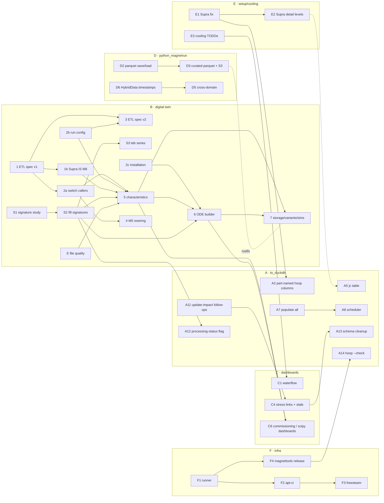

# magnetdb-duckdb-demo — Workspace Roadmap

*Snapshot: 2026-10-16 · branch `msite_to_assembly`*

Umbrella roadmap over every plan file in this repository and its four
submodules (`python_magnetrun`, `python_magnetsetup`, `python_magnetgeo`,
`python_magnetcooling`). It **links to** the detailed plans and the two
component roadmaps rather than repeating them:

- [to_duckdb/ROADMAP.md](to_duckdb/ROADMAP.md) — detailed `to_duckdb` history, last updated 2026-08-21
- [python_magnetrun/prompts/ROADMAP.md](python_magnetrun/prompts/ROADMAP.md) — detailed `python_magnetrun` history, last updated 2026-06-11
- [PLAN_digital_twin_schema.md — Cross-plan order](PLAN_digital_twin_schema.md#cross-plan-order-blockers-and-approvals) — authoritative order for track B
- [PLAN_m1_project_sort.md](PLAN_m1_project_sort.md) — themed sort of the 50-item M1 note

Statuses below were checked against code and git history on 2026-10-16,
not only against each plan's own status line (see
[Status drift to fix](#status-drift-to-fix)).

**Legend.**
Status: ✅ done · 🔄 in progress · 📝 drafted, awaiting approval ·
💡 idea / sketch, no approvable plan · ⛔ blocked on external input ·
⏸ tabled / deferred · ❌ superseded / dropped.
Effort (relative, no calendar): S · M · L · XL · ? (not sizeable yet).

---

## Tracks at a glance

| Track | Scope | Open items | Next step |
|---|---|---|---|
| [A](#a--data-pipeline-to_duckdb) | `to_duckdb` schema, CLI, compute pipelines | 14 | approve A1 (exp-stats perf) and A2 (part-named hoop-stress columns) |
| [B](#b--digital-twin--etl) | installations, run config, characteristics, Pupitre ETL, signatures | 13 steps | approve B1 (Pupitre ETL spec v1); write plans for E and S1 |
| [C](#c--dashboards-appsdashboardsmagnetdb) | Dash app | 7 | reconcile C2; waterflow (C1) after E3 |
| [D](#d--python_magnetrun) | data-access library | 16 | decide on D1 spike branch; D2 parquet is ready to execute |
| [E](#e--python_magnetsetup--python_magnetgeo--python_magnetcooling) | setup / geometry / cooling libraries | 5 | approve E1 (Supra fix) — unblocks A2 and M8 |
| [F](#f--infrastructure-ci-packaging) | runner, apt depot, magnettools packaging | 5 | approve F1 → F2 → F3; F4 after F1 |
| [G](#g--external-integrations--research) | external DBs/APIs, research items | 10 | mostly blocked on external input |

---

## A — Data pipeline (`to_duckdb`)

### Done since the 2026-08-21 snapshot

| Item | Evidence |
|---|---|
| `operation_log` audit table + `magnetdb.py log` ([plan](to_duckdb/PLAN_operation_log.md)) | `e2389aa`; `schema.py`, `magnetdb.py` |
| Update-impact tracking: stale marking, `material update`, FK drop ([plan](PLAN_update_impact_tracking.md)) | approved + implemented 2026-10-08, `d7ede6a` (`to_duckdb/impact.py`) |
| Hoop-stress rainflow fatigue-bins matrix (`hoop_stress_fatigue_bins`) | in `schema.py`, committed — **no plan file was ever written** |
| Per-experiment hoop-stress processing record (`hoop_stress_processed`, `bin_config`, `stale_since`/`stale_reason`) | `schema.py:336-347` — covers the *stress* stage of the processing-status flag |
| `populate overview-records-from-json` | subcommand present in `magnetdb.py` |
| Lifecycle: auto-close at CRUD, enum-driven statuses | `5c938bd`, `753c056` |
| DB consistency check helper | `566e3f7`, `dd87797` |
| Fill missing `Magnet Sites` in proposals ([plan](PLAN_fill_magnet_sites.md)) | `Data/proposals_2026-07-22_with_sites.csv` |

Earlier work (dedup, hoop-stress Phases 1–5, lifecycle, site→assembly
rename Track A) is recorded in [to_duckdb/ROADMAP.md](to_duckdb/ROADMAP.md).

### Open

| ID | Item | Plan | Status | Effort | Depends on / blocker |
|---|---|---|---|---|---|
| A1 | `compute_exp_stats.py` ~3× faster, atomic per-file writes | [PLAN_exp_stats_performance.md](to_duckdb/PLAN_exp_stats_performance.md) | 📝 since 2026-10-09 | M | — (full reprocess ≈ 1.6 h today) |
| A2 | Hoop-stress columns named by part; Parquet sub-dir per assembly | [PLAN_hoop_stress_part_names.md](to_duckdb/PLAN_hoop_stress_part_names.md) | 📝 2026-10-15 | S–M | best after **E1** (M8 assemblies fail `load_magnettools` until then) |
| A3 | `incidents` entity linked to assembly/magnet/part + `status_history` | [PLAN_incident_tracking.md](to_duckdb/PLAN_incident_tracking.md) | 📝 since 2026-08-28 | M | — (M1 note item 31) |
| A4 | `part delete` command | [PLAN_part_delete.md](to_duckdb/PLAN_part_delete.md) | 📝 since 2026-08-28 | S | — (split from A3, independent) |
| A5 | `jc` table + supra-part `jc_name` link | [PLAN_jc_table.md](PLAN_jc_table.md) | 📝 since 2026-09-02 | S–M | relates to **E2** (detailed Supras) |
| A6 | Days-based date tolerance for fuzzy matching | [PLAN_fuzzy_date_tolerance.md](to_duckdb/PLAN_fuzzy_date_tolerance.md) | 📝 — partly covered by `d0fb3ce` (date check in `users_table_demo.py`) | S | — |
| A7 | `populate all` composite subcommand | [PLAN_populate_all.md](to_duckdb/PLAN_populate_all.md) | 💡 | S | opens: hard-fail policy, `--reprocess` scope |
| A8 | Scheduled populate (systemd timer + `--settle-seconds`) | [PLAN_scheduled_populate.md](to_duckdb/PLAN_scheduled_populate.md) | 💡 | S–M | A7 |
| A9 | Pluggable user sources (CSV / SUPERVISION MySQL / userdb API) | [PLAN_users_multi_source.md](to_duckdb/PLAN_users_multi_source.md) | 📝 Phase 1; ⛔ Phases 2–3 | M | SUPERVISION schema, userdb API shape — see [Q9](#open-questions) |
| A10 | EcoNRJ parameter inference (Tr, R, ImaxH, ImaxB) | [PLAN_econrj_parameter_inference.md](to_duckdb/PLAN_econrj_parameter_inference.md) | 💡 | M | meaning of `Tr`; fit granularity |
| A11 | Update-impact follow-ups 1–7 (stale display, drift detection, insert angles, bores, use `magnets.geometry_data`, portable geometry paths, update coverage) | [PLAN_update_impact_tracking.md §Follow-ups](PLAN_update_impact_tracking.md) | 💡 each needs its own plan | S each | #1 feeds **C4**; #5 conflicts with A13 — see [Q2](#open-questions) |
| A12 | Processing-status flag for the remaining stages (fatigue, signatures, plateaux, …) | — none | 💡 partly done (stress stage via `hoop_stress_processed`) | S–M | B S2 (defines the signature/plateaux stages) |
| A13 | Schema cleanup: drop `operationaldata`, `sum_x2_dt`, `exp_part_bin_stats`, maybe `magnets.geometry_data` | [to_duckdb/TODOs.md](to_duckdb/TODOs.md) | 💡 | ? | C4 (retire `part_stats.py` consumers first); [Q2](#open-questions) |
| A14 | Hoop-stress `--check` mode against `magnettools.Bmap.getHoop()` | [to_duckdb/TODOs.md](to_duckdb/TODOs.md) (POSTPONED) | ⛔ | S | fix in `~/github/my-magnettools`, then a reinstall — **F4** makes this routine |

---

## B — Digital twin & ETL

Order, blockers and approvals come from
[PLAN_digital_twin_schema.md](PLAN_digital_twin_schema.md#cross-plan-order-blockers-and-approvals)
(as of 2026-10-07). **Only step 0 and the S1 methodology are approved.**
Steps 1, E, S1, 2b and 2c can run in parallel. This track takes over
`to_duckdb/ROADMAP.md`'s former Open Questions 1 (lag) and 2 (plateaux), and
its Later item "Commissioning data structure".

| Step | Work | Plan | Status | Depends on | Blocker |
|---|---|---|---|---|---|
| 0 | Reconcile plan documents | — | ✅ 2026-10-07 | — | — |
| E | File quality on `experiments` (`header_class`, `file_integrity`, `file_checks`) | to write — see L2 in the [schema plan](PLAN_digital_twin_schema.md) | 💡 | — | none |
| S1 | Signature regime robustness study (incl. lag Side A vs Side B, robust `Field` signature) | [PLAN_signature_regime_robustness.md](apps/dashboards/magnetdb/PLAN_signature_regime_robustness.md) | 📝 methodology approved, not run | — | tooling location; RDP vs PELT; test-file set |
| S2 | Fill `overview_records.signatures`/`plateaux`/`sync_info` with real output | to write | 💡 | S1 | — |
| S3 | `teb` as a time series, shifted by stored lag | to write | 💡 | S2 | one-offset-per-file assumption |
| 1 | Pupitre ETL spec v1 | [PLAN_pupitre_etl_spec.md](PLAN_pupitre_etl_spec.md) | 📝 since 2026-10-07 | — | none |
| 1b | Supra current `IS` for M8; hybrid loading moved into python_magnetrun | outline in [PLAN_pupitre_etl_spec.md](PLAN_pupitre_etl_spec.md) | 💡 outline agreed | 1 | #27 Hybrid ↔ pupitre clock lag (M8 work started, `00e6467`) |
| 2a | Switch Pupitre callers (`load_mrun`, dashboards, `stress_map.py`) to the spec path | to write | 💡 | 1 | — |
| 2b | Phase 2: probes + L2 run configuration + `v_config_sections` | to write | 💡 | — | #2, #17, #20 (MAGFILE support landed in python_magnetrun `fc3dc54`) |
| 2c | Phase 1: L1 installation (PID, Ivar) | to write | ⛔ | — | **CIRRUS XML history access** |
| 3 | Pupitre ETL spec v2, driven by the assembly | to write | 💡 | 1, 2b | — |
| 4 | M5 rewiring | [NOTES_M5_bitters_wiring.md](NOTES_M5_bitters_wiring.md) | ⏸ notes on hold | 2a, (3) | formal confirmation of M5 wiring |
| 5 | Phase 3: L3 characteristics + raw commissioning tables | to write | 💡 | 2a, 2b, 1b, S2, E | #22–#25 |
| 6 | Phase 4: ODE config builder (magnet_scipy inputs) | to write | 💡 | 2c, 5, S2 | `materials.alpha`; empty signatures until S2 |
| 7 | Phases 5–7: storage, L4 digital variants, L5 simulations | to write | 💡 | 5, 6 | #10 rustfs instance (shared with **D3**) |
| — | Commissioning measurements + numerical companion | [PLAN_commissioning_numerical_companion.md](PLAN_commissioning_numerical_companion.md) | ❌ superseded — §1 merged into step 5 | — | — |

---

## C — Dashboards (`apps/dashboards/magnetdb`)

### Done since the 2026-08-21 snapshot

| Item | Plan | Evidence |
|---|---|---|
| i18n (en/fr/de/nl) + 🌐 selector | [PLAN_dashboard_i18n.md](PLAN_dashboard_i18n.md) | `d1cecff`, `b0b1bd3` (`src/i18n.py`) |
| Database summary banner | [PLAN_database_summary_banner.md](PLAN_database_summary_banner.md) | `df0ca56`, `df3b273` |
| Graph CSV download | [PLAN_graph_csv_download.md](PLAN_graph_csv_download.md) | `19e67c5` |
| Click-to-pin cursor sync | [PLAN_cross_graph_cursor_sync.md](apps/dashboards/magnetdb/PLAN_cross_graph_cursor_sync.md) | `d3a2c89` |
| Per-field style overrides + gear icon | [PLAN_field_style_overrides.md](apps/dashboards/magnetdb/PLAN_field_style_overrides.md) | `style_editor.py`, used on 3 pages |
| Sensor group order | [PLAN_group_order.md](apps/dashboards/magnetdb/PLAN_group_order.md) | `53aa756` |
| Date filters on Experiments/Overview tables | [PLAN_experiment_overview_date_filters.md](apps/dashboards/magnetdb/PLAN_experiment_overview_date_filters.md) | committed |
| Per-region loading spinner | [PLAN_loading_spinner_scope.md](apps/dashboards/magnetdb/PLAN_loading_spinner_scope.md) | `bf52c5a` |
| SUPERVISION `bdd` data in viewers | [PLAN_supervision_bdd_file_viewer.md](PLAN_supervision_bdd_file_viewer.md) | `8089706` |
| Incident-file curves on Defaults & Spikes | [PLAN_defaults_spikes_incident_data.md](apps/dashboards/magnetdb/PLAN_defaults_spikes_incident_data.md) | 2026-10-15, `0afaeb9` |
| Hoop-stress history in Part stats | [PLAN_part_stats_hoop_stress.md](apps/dashboards/magnetdb/PLAN_part_stats_hoop_stress.md) | committed |
| Research-area, TDMS stats viewer, About pages; magnet-time coloured by field range; DB-change callback | — | `048cb57`, `5d66fab`, `d24a82d`, `7155c22`, `f7ebd36` |

### Open

| ID | Item | Plan | Status | Effort | Depends on / blocker |
|---|---|---|---|---|---|
| C1 | Waterflow comparison page (+ root fix of cwd-dependent `importlib.resources`) | [PLAN_waterflow_dashboard.md](PLAN_waterflow_dashboard.md) | 📝 no status line, not implemented | M | **E3** (waterflow_factory rework); the resources part may be partly done (`597b56f`) |
| C2 | Click an event marker to lazily load that event file | [PLAN_overview_records_event_click.md](apps/dashboards/magnetdb/PLAN_overview_records_event_click.md) | 📝 draft, diverged | S | possibly superseded by the eager toggle + Defaults & Spikes curves — [Q3](#open-questions) |
| C3 | Magnet stats Housing/Year filter | [PLAN_magnet_stats_year_filter.md](apps/dashboards/magnetdb/PLAN_magnet_stats_year_filter.md) | ⏸ tabled 2026-08-20 | S | — |
| C4 | Stress/fatigue linking in assembly/magnet stats; show stale results | [to_duckdb/ROADMAP.md](to_duckdb/ROADMAP.md) Later; A11 #1 | 💡 | S–M | A11 #1 |
| C5 | Table technology for trend columns (great_tables nanoplot vs DataTable+base64 vs ag-grid Enterprise) | [PLAN_m1_project_sort.md §3b](PLAN_m1_project_sort.md) | 💡 decision open | ? | [Q6](#open-questions) |
| C6 | M1-note dashboards: pigbrother `Champ_magn` in overview (13), fault annotations (26/30), commissioning (45), magnet_scipy comparison (46), energy balance (47) | [PLAN_m1_project_sort.md](PLAN_m1_project_sort.md) | 💡 | M each | 45 → B step 5; 46 → B step 6 |
| C7 | Comparison-page performance (`PERFORMANCE_PLAN.md`) | — | ❌ plan file removed; page in `pages_disabled/` | — | — |

---

## D — `python_magnetrun`

Only open and recent streams are listed here. Completed history lives in
[python_magnetrun/prompts/ROADMAP.md](python_magnetrun/prompts/ROADMAP.md).

### Done since that roadmap's 2026-06-11 update (not yet reflected there)

| Item | Plan | Evidence |
|---|---|---|
| Polars MagnetData for pupitre | [polars-magnetdata-pupitre.plan.md](python_magnetrun/prompts/polars-magnetdata-pupitre.plan.md) | ✅ in plan; `magnetdata_polars.py` |
| Narwhals downstream consumers | [narwhals-downstream-consumers.plan.md](python_magnetrun/prompts/narwhals-downstream-consumers.plan.md) | `6fec823` |
| TdmsMagnetData → polars by default; custom `nptdms` live (part of Stream 4.3) | [mrun-cache-implementation.plan.md](python_magnetrun/prompts/mrun-cache-implementation.plan.md) | `1892c37`; plan says ✅ Live |
| Trigger & VProcess plotting (Stream 4.6) | [4.6-trigger-vprocess-plotting.plan.md](python_magnetrun/prompts/4.6-trigger-vprocess-plotting.plan.md) | `plot_vprocess_variable` in `hybrid_data.py` |
| TDMS stats files, archive-TDMS file discovery, MAGFILE data, SUPERVISION `bdd` defs, MySQL export sort, thread-safe pint registry, bandit hook | — | `eea0dbe`, `3e57785`, `fc3dc54`, `5c827c5`, `077800f`, `6e22643`, `5362867` |

### Open

| ID | Item | Plan | Status | Effort | Depends on / blocker |
|---|---|---|---|---|---|
| D1 | TDMS polars export benchmark spike | [tdms-polars-benchmark.plan.md](python_magnetrun/prompts/tdms-polars-benchmark.plan.md) | 🔄 — the superproject pins branch `spike/tdms-polars-benchmark` | S | [Q1](#open-questions) |
| D2 | Parquet save/load with rich metadata (Stream 4.7, Phases 1–7) | [parquet-save-load.plan.md](python_magnetrun/prompts/parquet-save-load.plan.md) | 📝 fully designed (D1–D8), all ⏳ | M (~3 d) | — |
| D3 | Curated Parquet input + S3-backed file access | [curated-parquet-s3.plan.md](python_magnetrun/prompts/curated-parquet-s3.plan.md) | 💡 discussion notes | M | D2; rustfs instance (shared with B step 7) |
| D4 | Phase 2D side-by-side comparison (`plot_comparison(list[DataLoader])`) | [ROADMAP §2D](python_magnetrun/prompts/ROADMAP.md) | 💡 unblocked | M | — |
| D5 | Cross-domain comparison Phases D–G + 3.7 pattern entries in `*-defs.json` | `cross-domain-comparison.prompt.md`, [ROADMAP §4.2](python_magnetrun/prompts/ROADMAP.md) | 💡 (`ComparisonSession` not started) | L | D6 |
| D6 | `HybridData` timestamp support (Stream 4.1) | [hybriddata-timestamp-plan.md](python_magnetrun/prompts/hybriddata-timestamp-plan.md) | ❓ `addTime` present in `hybrid_data.py` — verify | S | — |
| D7 | snake_case migration with deprecation shims (required by CLAUDE.md) | [snake-case-migration.plan.md](python_magnetrun/prompts/snake-case-migration.plan.md) | 📝 Pass 1 not started; open questions in plan | L | — |
| D8 | Test coverage → 80 % | [coverage-80pct.plan.md](python_magnetrun/prompts/coverage-80pct.plan.md) | ❓ status unknown | M | — |
| D9 | Label/legend uniformization | [label-legend-uniformization.plan.md](python_magnetrun/prompts/label-legend-uniformization.plan.md) | ❓ plan shows 12 open steps; superproject `6577295`/`f3f9334` changed labels | S | verify |
| D10 | TDMS export (Stream 4.5) | [ROADMAP §4.5](python_magnetrun/prompts/ROADMAP.md) | 💡 | M ×3 | — |
| D11 | Multiple-file `vs_time` regression (Stream 1) | [ROADMAP §1](python_magnetrun/prompts/ROADMAP.md) | 💡 open since May | S | — |
| D12 | mypy, logging migration, quick wins | [ROADMAP](python_magnetrun/prompts/ROADMAP.md) | 💡 background | S | — |
| D13 | marimo tutorial notebooks | [marimo-tutorial.plan.md](python_magnetrun/prompts/marimo-tutorial.plan.md) | 💡 not started (only `.ipynb` notebooks exist) | M | — |
| D14 | Dash / pywry / Textual GUIs | [dash-plan](python_magnetrun/docs/dash-plan.md), [gui-plan](python_magnetrun/docs/gui-plan.md), [tui-plan](python_magnetrun/docs/tui-plan.md) | 💡 not started | L | overlaps track C — [Q4](#open-questions) |
| D15 | HoloViews plotting migration | [holoviews-migration.plan.md](python_magnetrun/prompts/holoviews-migration.plan.md) | ⏸ optional | M | — |
| D16 | Legacy TODO list (spike removal, smoothing, mrecord rework, …) | [python_magnetrun/TODO.md](python_magnetrun/python_magnetrun/TODO.md) | 💡 unsorted | ? | partly superseded by B |

---

## E — `python_magnetsetup` / `python_magnetgeo` / `python_magnetcooling`

| ID | Item | Plan | Status | Effort | Depends on / blocker |
|---|---|---|---|---|---|
| E1 | Fix the Supra branch of `magnet_setup` (`DetailLevel.NONE`), deb runtime deps, tests run at .deb build | [python_magnetsetup/PLAN_supra_umagnet.md](python_magnetsetup/PLAN_supra_umagnet.md) | 📝 2026-10-15 | M | — ; **unblocks A2 and the M8 assemblies** |
| E2 | Supra detail levels DBLPANCAKE / PANCAKE / TAPE | [python_magnetsetup/PLAN_supra_detail_levels.md](python_magnetsetup/PLAN_supra_detail_levels.md) | 📝 2026-10-16 | M–L | E1; relates to A5 (`jc`) |
| E3 | Cooling TODOs: thermohydraulics check (gradHZH), z-dependent dh/sh, waterflow_factory via magnetrun, mrun input for waterflow pipeline, secondary-flow hysteresis | [python_magnetcooling/TODOs.md](python_magnetcooling/TODOs.md) | 💡 no plans | ? | feeds C1 |
| E4 | Cooling models from the M1 student (primary heat exchanger) | [to_duckdb/ROADMAP.md](to_duckdb/ROADMAP.md) Later | ⛔ | M | student's models |
| E5 | `python_magnetgeo` | — | no open plans | — | Track B of the rename is under G3 |

---

## F — Infrastructure, CI, packaging

| ID | Item | Plan | Status | Effort | Depends on / blocker |
|---|---|---|---|---|---|
| F1 | Self-hosted GitHub runner on calcul22 (`ghrunner`, `MagnetDB/apt-depot` only) | [PLAN_github_runner_setup.md](PLAN_github_runner_setup.md) | 📝 | S | — |
| F2 | `apt-ci` upload path to euler + generic build workflow | [PLAN_apt_ci_upload.md](PLAN_apt_ci_upload.md) | 📝 | M | F1 |
| F3 | freesteam Debian package on release | [PLAN_freesteam_deb_ci.md](PLAN_freesteam_deb_ci.md) | 📝 | S | F1, F2 |
| F4 | magnettools release pipeline (deb + wheel + public image) | [PLAN_magnettools_release_pipeline.md](PLAN_magnettools_release_pipeline.md), [NOTES_auditwheel_spike.md](NOTES_auditwheel_spike.md) | 📝 | L | F1 (its step 9 revises "no runner"); unblocks magnettools installs → A14, hoop-stress tests |
| F5 | DuckDB ↔ PostgreSQL (`python_magnetdb`) merge strategy | [PLAN_duckdb_postgres_merge.md](PLAN_duckdb_postgres_merge.md) | 💡 discussion recorded, open question | ? | [Q10](#open-questions) |

---

## G — External integrations & research

| ID | Item | Source | Status | Blocker |
|---|---|---|---|---|
| G1 | B-profile → currents inversion; experiment-planning optimizer | [M1 sort §E](PLAN_m1_project_sort.md) | ⛔ | formula from Cedric/Romain |
| G2 | `python_magnetrun/requests` read **and write** to Cedric's DB; M7/M8 assembly configs | M1 sort §F (29/50) | ⛔ | authorization — [Q7](#open-questions) |
| G3 | Site→Assembly rename Track B (`python_magnetdb`, `python_magnetapi`) + magnetapi bulk-import test | [PLAN_site_to_assembly_rename.md](PLAN_site_to_assembly_rename.md) | ⏸ deferred | separate repos |
| G4 | Engie API linked to experiments | M1 sort §F (42) | 💡 | — |
| G5 | `hifimagnet-projects`: M7/M8 assembly setup, bitter status cleanup, bitter naming convention | [to_duckdb/TODOs.md](to_duckdb/TODOs.md), M1 sort §F/G | 💡 | cahier E. Verney |
| G6 | Field validation M8–M10 (`Field + Supra_Field == Total_Field`) | [to_duckdb/TODOs.md](to_duckdb/TODOs.md) | 💡 | — |
| G7 | Pre-2022 pigbrother data (NAS 2018–2021) | [to_duckdb/TODOs.md](to_duckdb/TODOs.md) | ⛔ | availability unknown |
| G8 | Special experiments (M19, negative IH/IB) | [to_duckdb/TODOs.md](to_duckdb/TODOs.md) | 💡 | schema design |
| G9 | Fix `python_magnetrun/examples/bilan.py`; update numerical commissioning | [to_duckdb/TODOs.md](to_duckdb/TODOs.md) | 💡 | the latter folds into B step 5 |
| G10 | Exploratory: ggsql spike, querychat over a local LLM | M1 sort §H | 💡 | — |

---

## Cross-track dependencies

---

## Awaiting your approval

Drafted plans that can start as soon as they are approved. **Bold**
marks the ones that unblock other work.

1. **E1** [PLAN_supra_umagnet.md](python_magnetsetup/PLAN_supra_umagnet.md) — unblocks A2, E2, the M8 assemblies
2. **F1** [PLAN_github_runner_setup.md](PLAN_github_runner_setup.md) — unblocks F2, F3, F4
3. **B1** [PLAN_pupitre_etl_spec.md](PLAN_pupitre_etl_spec.md) — head of track B
4. A1 [PLAN_exp_stats_performance.md](to_duckdb/PLAN_exp_stats_performance.md)
5. A2 [PLAN_hoop_stress_part_names.md](to_duckdb/PLAN_hoop_stress_part_names.md) (after E1)
6. A3 [PLAN_incident_tracking.md](to_duckdb/PLAN_incident_tracking.md) and A4 [PLAN_part_delete.md](to_duckdb/PLAN_part_delete.md)
7. A5 [PLAN_jc_table.md](PLAN_jc_table.md)
8. A6 [PLAN_fuzzy_date_tolerance.md](to_duckdb/PLAN_fuzzy_date_tolerance.md) (check what `d0fb3ce` already covers first)
9. E2 [PLAN_supra_detail_levels.md](python_magnetsetup/PLAN_supra_detail_levels.md) (after E1)
10. F2, F3, F4 (after F1)
11. C1 [PLAN_waterflow_dashboard.md](PLAN_waterflow_dashboard.md)
12. D2 [parquet-save-load.plan.md](python_magnetrun/prompts/parquet-save-load.plan.md) — design is complete

Plans still **to be written** before work can start: B steps E, S2, 2a, 2b, 2c;
A12; a short retro-plan for the already-committed `hoop_stress_fatigue_bins`
table.

---

## Status drift to fix

These plan files or roadmaps say something that git or the code contradicts.
They are listed here and **were not edited**.

| File | Says | Reality |
|---|---|---|
| [to_duckdb/ROADMAP.md](to_duckdb/ROADMAP.md) | snapshot 2026-08-21; fatigue-bins matrix and `overview-records-from-json` under "Next"; `PERFORMANCE_PLAN.md` under "Next" | both items landed; `PERFORMANCE_PLAN.md` no longer exists |
| [python_magnetrun/prompts/ROADMAP.md](python_magnetrun/prompts/ROADMAP.md) | updated 2026-06-11; 4.3 polars "deferred"; 4.6 "planned" | polars/narwhals/custom nptdms landed in September; 4.6 done |
| [to_duckdb/TODOs.md](to_duckdb/TODOs.md) | dashboard rework "(awaiting approval)"; "concat entries that share one pupitre file" unchecked | both done |
| [PLAN_hoop_stress_parquet_columns.md](to_duckdb/PLAN_hoop_stress_parquet_columns.md), [PLAN_hoop_stress_part_history.md](to_duckdb/PLAN_hoop_stress_part_history.md) | "pending approval, not started" | landed 2026-08-13 |
| [PLAN_hoop_stress_per_part_tests.md](to_duckdb/PLAN_hoop_stress_per_part_tests.md) | "done, uncommitted" | committed in `00f8636` |
| [PLAN_part_stats_hoop_stress.md](apps/dashboards/magnetdb/PLAN_part_stats_hoop_stress.md), [PLAN_experiment_overview_date_filters.md](apps/dashboards/magnetdb/PLAN_experiment_overview_date_filters.md), [PLAN_loading_spinner_scope.md](apps/dashboards/magnetdb/PLAN_loading_spinner_scope.md) | "implemented, uncommitted" | committed (working tree clean) |
| [PLAN_field_style_overrides.md](apps/dashboards/magnetdb/PLAN_field_style_overrides.md) | "Proposed, not yet implemented" | implemented (`style_editor.py`) |
| [PLAN_operation_log.md](to_duckdb/PLAN_operation_log.md), [PLAN_dashboard_i18n.md](PLAN_dashboard_i18n.md), [PLAN_database_summary_banner.md](PLAN_database_summary_banner.md), [PLAN_graph_csv_download.md](PLAN_graph_csv_download.md), [PLAN_cross_graph_cursor_sync.md](apps/dashboards/magnetdb/PLAN_cross_graph_cursor_sync.md), [PLAN_fill_magnet_sites.md](PLAN_fill_magnet_sites.md) | no status line | implemented (see track tables) |
| [PLAN_waterflow_dashboard.md](PLAN_waterflow_dashboard.md), [PLAN_overview_records_event_click.md](apps/dashboards/magnetdb/PLAN_overview_records_event_click.md) | no status line | not implemented |
| [PLAN_fuzzy_date_tolerance.md](to_duckdb/PLAN_fuzzy_date_tolerance.md) | "pending" | partly covered by `d0fb3ce` |
| `python_magnetrun/python_magnetcooling/TODOs.md` | — | a stray copy of [python_magnetcooling/TODOs.md](python_magnetcooling/TODOs.md) inside the magnetrun submodule |

---

## Open questions

1. **D1** — should the superproject stay pinned on python_magnetrun's
   `spike/tdms-polars-benchmark` branch, or go back to `msite_to_assembly`
   once the spike ends?
2. **A11 #5 vs A13** — update-impact follow-up 5 wants to *use*
   `magnets.geometry_data` in the hoop-stress computation, while schema
   cleanup lists it as vestigial. Which way?
3. **C2** — now that Defaults & Spikes plots incident curves, is the
   click-to-load event view still wanted, or can it be marked superseded?
4. **D14** — are the Dash/pywry/Textual GUI plans in `python_magnetrun/docs/`
   still wanted alongside `apps/dashboards/magnetdb`?
5. **B S1** — lag Side A (`synchronization.py`) vs Side B (Wolali's
   `get_lag()`): the comparison is still to run (see
   [to_duckdb/ROADMAP.md Open Question 1](to_duckdb/ROADMAP.md)).
6. **C5** — table technology for trend columns (great_tables selectively vs
   DataTable+base64 vs ag-grid Enterprise).
7. **G2** — is write access to Cedric's database something to pursue?
8. **B** — the 27 numbered open questions in
   [PLAN_digital_twin_schema.md](PLAN_digital_twin_schema.md#open-questions).
9. **A9** — does python_magnetrun's MySQL export (`077800f`) and
   `SUPERVISION_DATA_DIR` (`b81a491`) already give enough SUPERVISION schema
   knowledge to unblock Phase 2?
10. **F5** — the open question in
    [PLAN_duckdb_postgres_merge.md](PLAN_duckdb_postgres_merge.md).

---

## Suggested order

Ordered by dependency, not by date.

1. **Unblockers first:** E1 → A2; F1 → F2/F4. E1 makes the M8 assemblies
   usable; F4 makes magnettools installable everywhere (tests, A14).
2. **Cheap drafted work:** A1, A4, A3, A5 (A5 before E2), A6.
3. **Start track B in parallel:** B1, plus plans for E and S1. 2b and 2c as
   access allows.
4. **Library storage:** D2 → D3, coordinated with B step 7's rustfs need.
5. **Dashboards that follow the data:** C4 after A11 #1; C1 after E3;
   C6 after B steps 5–6.
6. **Housekeeping between larger items:** the [Status drift](#status-drift-to-fix)
   corrections, D11, D12, A13 once C4 has retired `exp_part_bin_stats`.
7. **External and research items (G)** as their blockers clear.

---

## Plan index

Every plan file in the workspace, mapped to its track.

| File | Track / status |
|---|---|
| **Repo root** | |
| [PLAN_apt_ci_upload.md](PLAN_apt_ci_upload.md) | F2 📝 |
| [PLAN_commissioning_numerical_companion.md](PLAN_commissioning_numerical_companion.md) | B ❌ superseded |
| [PLAN_dashboard_i18n.md](PLAN_dashboard_i18n.md) | C ✅ |
| [PLAN_database_summary_banner.md](PLAN_database_summary_banner.md) | C ✅ |
| [PLAN_digital_twin_schema.md](PLAN_digital_twin_schema.md) | B (master) |
| [PLAN_duckdb_postgres_merge.md](PLAN_duckdb_postgres_merge.md) | F5 💡 |
| [PLAN_fill_magnet_sites.md](PLAN_fill_magnet_sites.md) | A ✅ |
| [PLAN_freesteam_deb_ci.md](PLAN_freesteam_deb_ci.md) | F3 📝 |
| [PLAN_github_runner_setup.md](PLAN_github_runner_setup.md) | F1 📝 |
| [PLAN_graph_csv_download.md](PLAN_graph_csv_download.md) | C ✅ |
| [PLAN_jc_table.md](PLAN_jc_table.md) | A5 📝 |
| [PLAN_m1_project_sort.md](PLAN_m1_project_sort.md) | reference (C6, G) |
| [PLAN_magnetdb_duckdb_demo_extraction.md](PLAN_magnetdb_duckdb_demo_extraction.md) | ✅ executed 2026-08-26 |
| [PLAN_magnettools_release_pipeline.md](PLAN_magnettools_release_pipeline.md) | F4 📝 |
| [PLAN_pupitre_etl_spec.md](PLAN_pupitre_etl_spec.md) | B1 📝 |
| [PLAN_site_to_assembly_rename.md](PLAN_site_to_assembly_rename.md) | ✅ Track A; G3 ⏸ Track B |
| [PLAN_supervision_bdd_file_viewer.md](PLAN_supervision_bdd_file_viewer.md) | C ✅ |
| [PLAN_update_impact_tracking.md](PLAN_update_impact_tracking.md) | A ✅; A11 follow-ups |
| [PLAN_waterflow_dashboard.md](PLAN_waterflow_dashboard.md) | C1 📝 |
| [PROJECT_STRUCTURE_PLAN.md](PROJECT_STRUCTURE_PLAN.md) | reference (copy from `2026-m1-hifimagnet`) |
| [NOTES_M5_bitters_wiring.md](NOTES_M5_bitters_wiring.md) | B4 ⏸ |
| [NOTES_auditwheel_spike.md](NOTES_auditwheel_spike.md) | F4 |
| **to_duckdb/** | |
| [PLAN_econrj_parameter_inference.md](to_duckdb/PLAN_econrj_parameter_inference.md) | A10 💡 |
| [PLAN_exp_stats_performance.md](to_duckdb/PLAN_exp_stats_performance.md) | A1 📝 |
| [PLAN_fuzzy_date_tolerance.md](to_duckdb/PLAN_fuzzy_date_tolerance.md) | A6 📝 |
| [PLAN_hoop_stress_history.md](to_duckdb/PLAN_hoop_stress_history.md) (index) + [PLAN_hoop_stress_parquet_columns.md](to_duckdb/PLAN_hoop_stress_parquet_columns.md), [PLAN_hoop_stress_part_history.md](to_duckdb/PLAN_hoop_stress_part_history.md), [PLAN_hoop_stress_per_part_tests.md](to_duckdb/PLAN_hoop_stress_per_part_tests.md), [PLAN_hoop_stress_fatigue_additivity.md](to_duckdb/PLAN_hoop_stress_fatigue_additivity.md) | A ✅ Phases 1–5 |
| [NOTES_hoop_stress_implementation.md](to_duckdb/NOTES_hoop_stress_implementation.md) | A14 (known limitations of `--check`) |
| [PLAN_hoop_stress_part_names.md](to_duckdb/PLAN_hoop_stress_part_names.md) | A2 📝 |
| [PLAN_incident_tracking.md](to_duckdb/PLAN_incident_tracking.md) | A3 📝 |
| [PLAN_lifecycle_status.md](to_duckdb/PLAN_lifecycle_status.md) | A ✅ |
| [PLAN_operation_log.md](to_duckdb/PLAN_operation_log.md) | A ✅ |
| [PLAN_overview_records_pupitre_dedup.md](to_duckdb/PLAN_overview_records_pupitre_dedup.md) | A ✅ |
| [PLAN_part_delete.md](to_duckdb/PLAN_part_delete.md) | A4 📝 |
| [PLAN_populate_all.md](to_duckdb/PLAN_populate_all.md) | A7 💡 |
| [PLAN_scheduled_populate.md](to_duckdb/PLAN_scheduled_populate.md) | A8 💡 |
| [PLAN_users_multi_source.md](to_duckdb/PLAN_users_multi_source.md) | A9 📝 / ⛔ |
| [ROADMAP.md](to_duckdb/ROADMAP.md), [TODOs.md](to_duckdb/TODOs.md) | component roadmap / backlog |
| **apps/dashboards/magnetdb/** | |
| [PLAN_cross_graph_cursor_sync.md](apps/dashboards/magnetdb/PLAN_cross_graph_cursor_sync.md) | C ✅ |
| [PLAN_dashboard_hierarchy_rework.md](apps/dashboards/magnetdb/PLAN_dashboard_hierarchy_rework.md) | C ✅ (2026-08-19) |
| [PLAN_defaults_spikes_incident_data.md](apps/dashboards/magnetdb/PLAN_defaults_spikes_incident_data.md) | C ✅ |
| [PLAN_experiment_overview_date_filters.md](apps/dashboards/magnetdb/PLAN_experiment_overview_date_filters.md) | C ✅ |
| [PLAN_field_style_overrides.md](apps/dashboards/magnetdb/PLAN_field_style_overrides.md) | C ✅ |
| [PLAN_group_order.md](apps/dashboards/magnetdb/PLAN_group_order.md) | C ✅ |
| [PLAN_loading_spinner_scope.md](apps/dashboards/magnetdb/PLAN_loading_spinner_scope.md) | C ✅ |
| [PLAN_magnet_stats_year_filter.md](apps/dashboards/magnetdb/PLAN_magnet_stats_year_filter.md) | C3 ⏸ |
| [PLAN_overview_records_event_click.md](apps/dashboards/magnetdb/PLAN_overview_records_event_click.md) | C2 📝 |
| [PLAN_part_stats_hoop_stress.md](apps/dashboards/magnetdb/PLAN_part_stats_hoop_stress.md) | C ✅ |
| [PLAN_plot_style_config.md](apps/dashboards/magnetdb/PLAN_plot_style_config.md) | C ✅ (2026-08-19) |
| [PLAN_signature_regime_robustness.md](apps/dashboards/magnetdb/PLAN_signature_regime_robustness.md) | B S1 📝 |
| **python_magnetsetup/** | |
| [PLAN_supra_umagnet.md](python_magnetsetup/PLAN_supra_umagnet.md) | E1 📝 |
| [PLAN_supra_detail_levels.md](python_magnetsetup/PLAN_supra_detail_levels.md) | E2 📝 |
| **python_magnetcooling/** | |
| [TODOs.md](python_magnetcooling/TODOs.md) | E3 💡 |
| **python_magnetrun/** — open | |
| [prompts/tdms-polars-benchmark.plan.md](python_magnetrun/prompts/tdms-polars-benchmark.plan.md) | D1 🔄 |
| [prompts/parquet-save-load.plan.md](python_magnetrun/prompts/parquet-save-load.plan.md) | D2 📝 |
| [prompts/curated-parquet-s3.plan.md](python_magnetrun/prompts/curated-parquet-s3.plan.md) | D3 💡 |
| [prompts/hybriddata-timestamp-plan.md](python_magnetrun/prompts/hybriddata-timestamp-plan.md) | D6 ❓ |
| [prompts/snake-case-migration.plan.md](python_magnetrun/prompts/snake-case-migration.plan.md) | D7 📝 |
| [prompts/coverage-80pct.plan.md](python_magnetrun/prompts/coverage-80pct.plan.md) | D8 ❓ |
| [prompts/label-legend-uniformization.plan.md](python_magnetrun/prompts/label-legend-uniformization.plan.md) | D9 ❓ |
| [prompts/marimo-tutorial.plan.md](python_magnetrun/prompts/marimo-tutorial.plan.md) | D13 💡 |
| [docs/dash-plan.md](python_magnetrun/docs/dash-plan.md), [docs/gui-plan.md](python_magnetrun/docs/gui-plan.md), [docs/tui-plan.md](python_magnetrun/docs/tui-plan.md) | D14 💡 |
| [prompts/holoviews-migration.plan.md](python_magnetrun/prompts/holoviews-migration.plan.md) | D15 ⏸ |
| [python_magnetrun/TODO.md](python_magnetrun/python_magnetrun/TODO.md) | D16 💡 |
| [prompts/ROADMAP.md](python_magnetrun/prompts/ROADMAP.md) | component roadmap |
| **python_magnetrun/** — done (see its ROADMAP) | |
| `3.9-hybrid-code-quality`, `4.6-trigger-vprocess-plotting`, `analysis-plotting-to-plotting-subpackage`, `analysis-subpackage-refactoring`, `bprofile-implementation`, `cli-consolidation`, `data-property-abc`, `downsampling-metrics`, `downsampling-refactoring`, `fix-remaining-issues`, `hts-magnetdata`, `hybrid-formula-key-resolution`, `hybrid-subpackage-refactoring`, `l2-binary-reader-base`, `m4-downsampling`, `mrun-cache-implementation`, `narwhals-downstream-consumers`, `outlier-consolidation`, `phase2b-time-alignment`, `plotting-refactoring`, `polars-magnetdata-pupitre`, `rdp-downsampling`, `reader-container-refactoring`, `timestamp-utc-refactoring`, `truncated-pupitre-files` (all `.plan.md` in [prompts/](python_magnetrun/prompts/)) | D ✅ |
